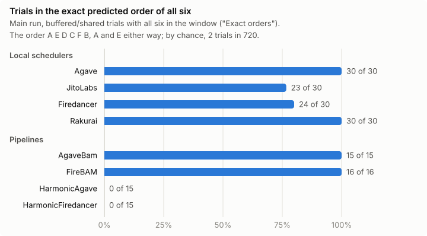
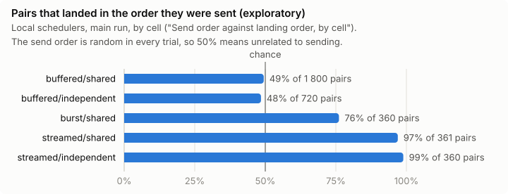

# Report: how Solana validators order transactions inside a block

**Contents.** [Summary](#summary) · [The answer](#the-answer) · [How to check](#how-to-check) ·
[Measurements, the date of every one](#measurements) · Results of the main run:
[runs and coverage](#1-runs-coverage-and-versions), [delivery](#2-delivery-and-attrition), [control](#3-control),
[primary tests](#4-primary-tests-the-local-schedulers), [pipelines](#5-pipelines-bam-and-harmonic),
[where the deviations are](#6-exact-orders-and-where-the-deviations-are-exploratory),
[arrival order](#7-arrival-order-the-cells-and-the-twins), [robustness](#8-robustness),
[context in the block](#9-context-in-the-block), [what the results do not show](#10-what-the-results-do-not-show) ·
[The confirmatory run](#the-confirmatory-run) · [The targeted run](#the-targeted-run) ·
[Known answers](#known-answers) · [What went wrong](#what-went-wrong) ·
[The pilot and the calibration](#before-the-main-run-the-pilot-and-the-calibration) · [The plan](#the-plan)

## Summary

**Question.** After Alpenglow, in what order does a Solana leader put transactions into its block, and does the rule
differ between validator clients?

**Method.** Each trial sends six of our own transactions over QUIC straight to the targeted leader, with fees chosen so
that the candidate rules predict different orders; their positions are read back from the chain. The main run made
403 trials on 2026-10-27 across 8 client labels. Its tests rest on the 181 trials delivered two slots before the
leader's window (buffered/shared), which reached 43 validators of the four local-scheduler labels and 42 behind the
BAM and Harmonic pipelines. Its analysis was frozen beforehand (git tag `prereg-main`).

**Findings.**
1. **Reward per requested cost.** At Agave, JitoLabs, Firedancer and Rakurai, the transactions waiting in the leader's
   buffer were ordered by reward per unit of cost computed from the *requested* limits: the formula of the Agave, Jito
   and Firedancer source (Rakurai's scheduler is a closed library). All 12 tests of the primary family hold, 107 of
   120 trials landed in the exact predicted order, and the contrasts put the share of the base fee counted as reward
   between 0.12 and 0.84 (the source: 0.5). The BAM pipelines ordered the same way (31 of 31). Harmonic ranked by fee
   too, but put the transaction with a 64 MiB loaded-data request last in all 30 trials, and B and C either way round.
2. **Some large validators differ within one client** (found after the main run). Three JitoLabs validators ordered
   by total priority fee instead. Two of them, Ledger by Figment and Everstake, the 7th and 8th largest by leader
   slots (3.90% of all leader slots together), were tested again on 30 new trials under a second plan frozen
   beforehand (git tag `prereg-confirm`): B before C, which total fee predicts and reward/cost does not, confirmed
   (29 of 30, Holm p < 0.001), and 29 of 30 in the exact total-fee order. Found later, exploratory: these orders do
   not separate total fee from "the larger requested compute-unit limit first"; Everstake's identity reported three
   different clients within ten days; and two of the three hold enabled accounts of Rakurai's activation program on
   chain, while none of the 13 JitoLabs validators that followed reward/cost does (section 6). Finding 4 tests that
   lead and the larger limit. A Firedancer validator that had left the exact order in 6 of 10 trials left it in 6 of 20
   new ones: not confirmed.
3. **Arrival order decides when nothing is held back** (found after the main run). Streamed 30 ms apart into a block
   being built, 97–99% of pairs at the local schedulers landed in send order. Between equal priorities, Firedancer
   landed the twin sent second first in 85% of 27 trials.
4. **A targeted run tested what finding 2 left open** (2026-11-04, epoch 1077, 126 new trials, a third plan frozen beforehand,
   git tag `prereg-rakurai`; "The targeted run").
   - **The Rakurai lead did not hold.** On new validators chosen by the account alone, holders and matched validators
     without one both put B before C in 22% of trials (four a side, Holm p = 0.643): not confirmed. Cogent, which holds no
     account, ordered by total fee in 7 of 8 trials.
   - **Total fee, not the larger limit, at Ledger by Figment.** With the parameters of B and D swapped, it put B, the larger
     fee on the smaller limit, before D in 12 of 12 trials (Holm p < 0.001): confirmed.
   - **The method sees a change of code predicted from the source.** At Jito 4.4.0 the twin sent first landed first in 78%
     [61–89%] of 32 trials (Holm p = 0.002), against 42% [29–55%] at 4.3.2: confirmed.
   - **Exploratory.** In the same 12 minutes, on the same reported client and version, Helius followed reward/cost in 10 of
     10 trials and Ledger by Figment total fee in 9 of 10, so this is not a day effect. Everstake, now reporting a Harmonic
     client, landed 10 of 10 with F last, as Harmonic does. One validator, `Ha1iade1`, went through all three orders in
     73 minutes, reporting one client in the snapshots before and after.

**Validator by validator** (exploratory; over the main and confirmatory runs, `results.md`, "Validator by validator"). The 10 of our 85
validators with at least 5 trials with all six in the window, by rank in leader slots. A reading needs one order in at
least 80% of them. Names are what each identity publishes on chain, self-declared.

| rank | validator | name on chain | label | trials | reward/cost | total fee | other orders | most frequent order [95%] | reading |
|---:|---|---|---|---:|---:|---:|---:|---|---|
| 2 | `HEL1USMZ` | Helius | JitoLabs 4.3.2 | 5 | 5 | 0 | 0 | 100% [57–100%] | reward/cost |
| 7 | `C8Bey3LK` | Ledger by Figment | JitoLabs 4.3.2 | 16 | 0 | 15 | 1 | 94% [72–99%] | total fee |
| 8 | `EvnRmnMr` | Everstake | JitoLabs 4.3.2 | 19 | 0 | 19 | 0 | 100% [83–100%] | total fee |
| 10 | `JD549Hsb` | Forward Industries | Firedancer 26.10.4 | 30 | 18 | 0 | 12 | 60% [42–75%] | mixed |
| 16 | `9jxgosAf` | – | FireBAM 26.10.4 | 7 | 7 | 0 | 0 | 100% [65–100%] | reward/cost |
| 48 | `ana2y2Yv` | Anagram Staking | Rakurai 4.3.2 | 12 | 12 | 0 | 0 | 100% [76–100%] | reward/cost |
| 56 | `7QQGNm3p` | – | Agave 4.3.2 | 10 | 10 | 0 | 0 | 100% [72–100%] | reward/cost |
| 90 | `5Us18hLZ` | – | Agave 4.3.2 | 10 | 10 | 0 | 0 | 100% [72–100%] | reward/cost |
| 110 | `E3mDbFMr` | MAVAN | Rakurai 4.3.2 | 5 | 5 | 0 | 0 | 100% [57–100%] | reward/cost |
| 117 | `7PdKhpKz` | Alpha Pro High APY… | Rakurai 4.3.2 | 9 | 9 | 0 | 0 | 100% [70–100%] | reward/cost |

The other 75 have 1 to 4 such trials each: too few for a reading of their own, and `results.md` lists every one. Pooled,
the 56 of the local labels and BAM landed 76 of 78 trials in the reward/cost order and 2 in the total-fee order; the 19
of Harmonic landed 30 of 30 with A, E, D first and F last. The verdicts per label below rest on such pooled trials. The
targeted run gives eight more validators a reading of their own ("The targeted run"). README's first table gathers all
18 over the three runs (`results.md`, "Every validator with a reading, all runs").

**Limits.** One unstaked sender. Most validators have too few trials for a reading of their own (above). BAM and
Harmonic are measured from their shared gateways, as whole pipelines. Our six out-rank 79–99% of their blocks, so this
is how the head of the queue is ranked. The validators reached hold about 22% of the leader slots of each family. One
day in epoch 1069, a confirmatory day for three validators, and a targeted day in epoch 1077 for 11. Versions have moved
on: by a snapshot of 2026-11-03, most validators report Agave 4.4 or Firedancer 26.10.5. The comparison of clients rests
on the older versions; the targeted run covers those 11 only, nine of them JitoLabs.

**How to check.** `docker compose up` regenerates every table from the committed raw data, checks a sample of blocks
against the chain, needs no keys, and ends with PASS or FAIL. `show <run> <trial>` reads any one trial from the chain.
Every landed transaction of every run was checked against the chain whole, with no problems. Total spend: 0.035684 SOL,
under the 0.05 SOL cap in code.

**Status: final, revised 2026-11-05.** The revisions add exploratory tables, names and sources ("The plan", "Added
after both runs"), a targeted run ("The targeted run"), and known answers on simulated leaders ("Known answers"). None
changes an earlier test or verdict. Below, "both
runs" means the main and the confirmatory run. The main run was campaign `main`, on 2026-10-27 in epoch 1069, six days
after Alpenglow. Its analysis plan was frozen at the git tag `prereg-main` before the first trial:
- commit `9221dc9`, dated 2026-10-27 14:34:07 UTC by its author;
- GitHub started CI for that commit at 14:34:11 UTC, on the push of `main`
  ([run](https://github.com/bobxx22/solana-ordering/actions/runs/40522357305)), and at 14:34:13 UTC on the push of the
  tag ([run](https://github.com/bobxx22/solana-ordering/actions/runs/40522361323)): times the author does not set;
- the campaign's first run started at 14:39:06 UTC ("Runs"). Its first transactions landed in slot 462 107 436, whose
  block time on chain is 14:39:08 UTC.

A confirmatory run, campaign `confirm`, tested two findings of the main run again on new trials, on 2026-10-28 in
epoch 1070 ("The confirmatory run"). Its plan, [`docs/CONFIRM.md`](docs/CONFIRM.md), was frozen the same way, at the
git tag `prereg-confirm`:
- commit `e0dc4a0`, dated 2026-10-28 17:22:35 UTC by its author;
- GitHub started CI for that commit at 17:22:39 UTC, on the push of `main`
  ([run](https://github.com/bobxx22/solana-ordering/actions/runs/40735122453)), and at 17:22:41 UTC on the push of the
  tag ([run](https://github.com/bobxx22/solana-ordering/actions/runs/40735127225));
- the run that made the trials started at 17:25:00 UTC ("Runs"). Its first transactions landed in slot 462 560 008,
  whose block time on chain is 17:25:13 UTC. Two earlier starts sent no trial ("What went wrong").

A targeted run, campaigns `rakurai` and `rakurai-swap`, tested on new trials what section 6 had left open, on 2026-11-04
in epoch 1077 ("The targeted run"). Its plan, [`docs/RAKURAI.md`](docs/RAKURAI.md), was frozen the same way, at the git
tag `prereg-rakurai`:
- commit `0dadd59`, dated 2026-11-03 22:40:33 UTC by its author;
- GitHub started CI for that commit at 22:40:39 UTC, on the push of `main`
  ([run](https://github.com/bobxx22/solana-ordering/actions/runs/41732866389)), and at 22:40:41 UTC on the push of the
  tag ([run](https://github.com/bobxx22/solana-ordering/actions/runs/41732872600));
- its first run started at 13:19:56 UTC on 2026-11-04 ("Runs"). Its first transactions landed in slot 465 316 632, whose
  block time on chain is 13:20:51 UTC.

**Where the numbers come from.**
- Results are copied from [`results.md`](data/mainnet-beta/results/results.md), and trial by trial from
  [`orders.md`](data/mainnet-beta/results/orders.md). `node src/cli.ts analyze` regenerates both from the committed raw
  data. The section a number comes from is quoted in double quotes.
- Spend comes from [`ledger.jsonl`](data/mainnet-beta/ledger.jsonl). Wallet balances come from transactions on chain,
  named where they are used.
- The chain checks come from [`verify.json`](data/mainnet-beta/verify.json), [`verify/`](data/mainnet-beta/verify/),
  [`verify-every-transaction.json`](data/mainnet-beta/verify-every-transaction.json),
  [`verify-every-transaction-confirm.json`](data/mainnet-beta/verify-every-transaction-confirm.json),
  [`verify-every-transaction-rakurai-swap.json`](data/mainnet-beta/verify-every-transaction-rakurai-swap.json) and
  [`verify-every-transaction-rakurai.json`](data/mainnet-beta/verify-every-transaction-rakurai.json).
- Names and Rakurai's activation accounts come from
  [`validator-names.json`](data/mainnet-beta/validator-names.json) and
  [`rakurai-activation.json`](data/mainnet-beta/rakurai-activation.json), read from the chain on 2026-11-03, after the
  main and confirmatory runs; the names again on 2026-11-04, after the targeted run, to cover its validators.
- The simulations come from [`known-answers.md`](data/mainnet-beta/results/known-answers.md), regenerated by
  `reproduce`.
- A few numbers add up rows of one table, and show the sum. Power figures are exact binomial computations, with the
  formula shown.
- Sections of `results.md` added after the data are marked "exploratory" there and here. "The plan" lists every
  addition.

## The answer

**The six roles** (terms: README, "Terms"). Each trial sends six transactions whose fees make the candidate rules
disagree:
- A and E, identical twins: 4 000 lamports of priority fee for a 1 000 compute-unit limit;
- B: 10 000 lamports for 40 000 compute units;
- C: no priority fee;
- D: 9 000 lamports for 6 000 compute units;
- F: A with a 64 MiB loaded-data limit.

By **reward per requested cost unit**, the formula in the deployed source of Agave 4.3.2 and Firedancer 26.10
(`docs/schedulers.md`), they rank A = E, D, C, F, B. Reward is the priority fee plus half of the base fee; cost is the
scheduling cost computed from the *requested* compute-unit and loaded-accounts-data limits. By total priority fee they
would rank B, D, A = E = F, C.

Three contrasts each isolate one term of that formula:
- **C before B** and **D before C** together place the share of the base fee counted as reward between 0.12 and
  0.84. The source uses 0.5.
- **A,E before F** shows that the requested loaded-data limit enters the cost.
- **A,E before C** is the positive control.

### Tested as pre-registered

- **Local schedulers:** Agave, JitoLabs (Jito-Agave), Firedancer and Rakurai, 32.7% of mainnet's leader slots, of
  which the validators we reached hold 22.2% ("Coverage per label"). The transactions waiting in the leader's buffer
  are ordered by reward per requested cost unit. All twelve tests of the primary family hold, at Holm p ≤ 0.003, and
  107 of the 120 trials landed in the exact order of all six. Agave and Rakurai each rest on about four effective
  validators. Every conclusion is about the validators reached.
- **Pipelines:** BAM and Harmonic, 67.1% of the slots, 22.8% reached. BAM ordered our transactions like the clients'
  schedulers, 31 of 31 trials in the exact order. For Harmonic, A,E before F and D before C hold, C before B is "no
  stable order", and no trial landed in the exact order. 10 of the family's 12 tests hold.

| label | share of leader slots | primary trials | control: A,E before C | A,E before F | C before B | D before C | exact order of all six |
|---|---:|---:|---|---|---|---|---:|
| Agave | 1.1% | 30 | 100% | 100% **holds** | 100% **holds** | 100% **holds** | 30 / 30 |
| JitoLabs | 24.9% | 30 | 100% | 87% **holds** | 77% **holds** | 100% **holds** | 23 / 30 |
| Firedancer | 5.5% | 30 | 100% | 100% **holds** | 90% **holds** | 100% **holds** | 24 / 30 |
| Rakurai | 1.2% | 30 | 100% | 100% **holds** | 100% **holds** | 100% **holds** | 30 / 30 |
| AgaveBam | 34.6% | 15 | 100% | 100% **holds** | 100% **holds** | 100% **holds** | 15 / 15 |
| FireBAM | 1.9% | 16 | 100% | 100% **holds** | 100% **holds** | 100% **holds** | 16 / 16 |
| HarmonicAgave | 21.9% | 15 | 100% | 100% **holds** | 33% **no stable order** | 100% **holds** | 0 / 15 |
| HarmonicFiredancer | 8.7% | 15 | 100% | 100% **holds** | 40% **no stable order** | 100% **holds** | 0 / 15 |

Shares are per-trial shares of the contrast's pairs in the named order, averaged over trials ("Primary",
"Pipelines"). Verdicts follow the pre-registered rule: a one-sided exact test against chance, Holm-adjusted within each
family of twelve; "holds" means more often than chance. Slot shares are from "Coverage per label", the last column
from "Exact orders".



### Found after the data (exploratory), and tested again

These come from tables added after the main run ("The plan"). They locate and describe; they test nothing.
- **Three JitoLabs validators order by total fee** (section 6). All 7 of their trials landed in the exact total-fee
  order; the other 13 JitoLabs validators we reached, 23 of 23 in the reward/cost order. Two of the three, Ledger by
  Figment and Everstake, are the 7th and 8th largest validators by leader slots. The same orders fit a rule that puts
  the larger requested compute-unit limit first; section 6 says how far the reading goes, and the targeted run
  separated the two at Ledger by Figment, for total fee.
- **One Firedancer validator departs** (section 6). JD549Hsb (Forward Industries): 4 of 10 trials in the exact order;
  the other 9, 20 of 20.
- **Harmonic** put F last in all 30 trials, and B and C either way round (section 6). These are the reward/cost orders
  for a base-fee share between 0.11 and 0.19 instead of 0.5; the design cannot tell that from a cost formula of
  Harmonic's own.
- **Arrival order** decides when the leader does not hold the transactions together (section 7). Streamed 30 ms apart
  into a block being built, 97–99% of pairs landed in send order, against 48–49% when buffered. Of two equal
  priorities, Firedancer landed the one sent second first in 85% of trials, consistent with its source.



A pattern found in the data cannot be tested on the same data. The first two findings were tested again on 53 new
trials, under a plan frozen before the first of them ("The confirmatory run"). 7cVfgArC had stopped voting, so H1
rests on the other two.

| | prediction | trials | result | Holm p | verdict |
|---|---|---:|---|---:|---|
| H1 | JitoLabs EvnRmnMr and C8Bey3LK put B before C, as total fee does | 30 | B before C in 97% [90–100%] | < 0.001 | **confirmed** |
| H2 | Firedancer JD549Hsb lands fewer than 80% of its trials in the exact reward/cost order | 20 | exact in 70% [48–85%] | 0.196 | **not confirmed** |

- **H1.** B before C is what total fee predicts and reward/cost does not. Among the candidate rules that put B before
  C, the whole order picks total fee: 29 of the 30 trials landed in the exact total-fee order. It does not separate
  total fee from the larger requested compute-unit limit first (section 6); the targeted run does, at C8Bey3LK.
- **H2.** JD549Hsb departed again, in 6 of 20 trials, but not significantly more often than the reference allows.
  Against that rate the test had little power: not confirmed is not refuted.

Then three predictions about what section 6 had left open, on 126 new trials under a third frozen plan ("The targeted
run"):

| | prediction | trials | result | Holm p | verdict |
|---|---|---:|---|---:|---|
| H1 | on new JitoLabs validators, holders of a Rakurai activation account put B before C more than matched validators without one | 64 | holders 22%, matched 22% (four a side) | 0.643 | **not confirmed** |
| H2 | with the parameters of B and D swapped, C8Bey3LK puts B before D, as total fee does and the larger limit first does not | 12 | 100% [76–100%] | < 0.001 | **confirmed** |
| H3 | at Jito 4.4.0, unlike 4.3.2, the twin sent first lands first, as the source says | 32 | 78% [61–89%] | 0.002 | **confirmed** |

## How to check

```bash
docker compose up
```

This command:
- regenerates every table, and the known answers, and compares them byte for byte with the committed ones;
- checks a sample of 120 blocks against the chain through public endpoints;
- makes one dry-run trial.

It takes about 10 minutes on the rate-limited public endpoints (7 to 21 in CI), says where it is as it goes, and ends
with PASS or FAIL and what was checked. It needs no keys and sends nothing. GitHub Actions runs it on every push
([runs on `main`](https://github.com/bobxx22/solana-ordering/actions/workflows/ci.yml?query=branch%3Amain); the
newest is for the commit you are reading): the job `docker` runs the offline part in the image, and the job
`reproduce-online` runs the whole command.

- `node src/cli.ts verify all --sample all` checks every landed transaction whole. The committed results are
  `verify-every-transaction.json` for the runs up to the main run, `verify-every-transaction-confirm.json` for the
  confirmatory run, and `verify-every-transaction-rakurai-swap.json` and `verify-every-transaction-rakurai.json` for
  the targeted run.
- `docker compose run --rm ordering show <run> <trial>` reads one trial from the chain and compares it with what we
  recorded (`orders.md` lists them): slot, position, fee, limits and leader come from public RPC, and only the send
  order and the names of the roles from our log. For example `show 2026-11-04T13-19-54Z 0`, a trial at Ledger by Figment
  with the swapped parameters, or `show 2026-10-27T15-32-51Z 249`, the trial below.
- To send real transactions from your own wallet, into a directory of their own: README, "Run it yourself on mainnet".
- `git log prereg-main`, `git log prereg-confirm` and `git log prereg-rakurai` show the three plans as frozen. The run
  directories are named by their UTC start.
- The git tag `submission` marks the version first handed in for the bounty, `submission-final` the last one before its
  deadline. Nothing between them adds a trial or changes a test ("The plan", "Added on 2026-11-05").

**One trial by hand.** Trial 249 of session 2 went to the Agave 4.3.2 validator 5Us18hLZ, for its window from slot
462 133 072 (`orders.md`). It was sent in the order D A E C B F. The six landed as the first six transactions of that
slot's block:

| index | role | priority fee, lamports | signature |
|---:|---|---:|---|
| 0 | E | 4 000 | [4uHMPzNZ…](https://explorer.solana.com/tx/4uHMPzNZf6RLdBrCewC5u16iLsedCA1YHAX3p62aKrFpQxh7PW4JchVSaHJJwgmy5BCeosUX1nD6EhL4vbR2ia9Y) |
| 1 | A | 4 000 | [3VQBhCSe…](https://explorer.solana.com/tx/3VQBhCSeQkrsN8wYvwMC8BGBqgtgDkuKgBfSxVU7DznnfzoCtFWGZzW76TMEYEgYmSDMx71YZoPEV4c2M2eW2vrf) |
| 2 | D | 9 000 | [4CkmLSe4…](https://explorer.solana.com/tx/4CkmLSe4NyfNiZBqm38FWp2xMTzcocpxohoWXBSmFE6znX6foUa24WtUdfRAD7MLaT6UBzrrQs8tMLB1EfdthvWK) |
| 3 | C | 0 | [2qa4pgik…](https://explorer.solana.com/tx/2qa4pgiknj68vZiB5fvGAXzLkjXpfxp5TBXVhqMvnTkVoTMGKgkPCmYeqJ8yApHNNAEQ2GDgJLekDpbTHK2mC3ct) |
| 4 | F | 4 000 | [48QFUnnB…](https://explorer.solana.com/tx/48QFUnnB9j6zMPkekJY1Ww5Gi6NRiYpfAkZHP2V8C3X6mD1Hq12JBaAzLTdXoKxXNVNHoFaWB6NPVVhicVukNmka) |
| 5 | B | 10 000 | [52C1m8zN…](https://explorer.solana.com/tx/52C1m8zN344QNGQTXNQkt1rwrdPv1NW1dJ78q6Cx9f2Uj44Q9GvvRhgeaYtqzZjG93E1HXvK8EwxYd6YzUKdzDS5) |

The block's signatures, in order, from a public endpoint:

```bash
curl -s https://api.mainnet-beta.solana.com -H 'content-type: application/json' -d '{"jsonrpc":"2.0","id":1,"method":"getBlock","params":[462133072,{"transactionDetails":"signatures","rewards":false,"maxSupportedTransactionVersion":1}]}'
```

On each transaction's explorer page the ComputeBudget instructions show its role. A and E have the same instructions;
F differs from them only in `SetLoadedAccountsDataSizeLimit`.

## Measurements

All times UTC. Every slot is after Alpenglow's activation (slot 459 653 000, 2026-10-21). Slots and epochs are from
"Runs"; spend is from `ledger.jsonl`.

| date and time | what | path | data | slots | spent, SOL |
|---|---|---|---|---|---:|
| 2026-10-24 16:59 | validator snapshot by client | – | `snapshots/` | epoch 1066 | 0 |
| 2026-10-24 19:07 | funding 10 sub-payers | RPC | `ledger.jsonl` | – | 0.000010 |
| 2026-10-24 19:08–19:12 | pilot: 15 trials × 5 transactions | public RPC | `runs/2026-10-24T19-08-02Z/` | 460 963 380 – 460 964 625 | 0.000780 |
| 2026-10-24 19:30–19:31 | path probe: 8 single transactions per endpoint, 3 endpoints | 3 RPCs | `paths/` | – | 0.000207 |
| 2026-10-24 23:25 | QUIC feasibility: 6 single transactions straight to leaders | direct QUIC | `quic-test/2026-10-24T23-25Z*.jsonl` | 461 036 036 – 461 036 146 | 0.000054 |
| 2026-10-24 23:35–23:37 | calibration 1: 8 trials × 6 (buffered sent one slot ahead, not two) | direct QUIC | `runs/2026-10-24T23-35-52Z/` | 461 039 133 – 461 039 486 | 0.000371 |
| 2026-10-25 15:38–15:41 | calibration 2: 13 trials × 6 | direct QUIC | `runs/2026-10-25T15-38-55Z/` | 461 311 213 – 461 311 909 | 0.000732 |
| 2026-10-25 22:02–22:07 | rehearsal of the final code: 16 + 1 trials, the second run continuing the first | direct QUIC | `runs/2026-10-25T22-02-17Z/`, `runs/2026-10-25T22-05-59Z/` | 461 419 536 – 461 420 912 | 0.000986 |
| 2026-10-27 14:39–14:42 | **main run, session 1:** 30 trials × 6, ended by a power loss | direct QUIC | `runs/2026-10-27T14-39-05Z/` | 462 107 436 – 462 108 452 | 0.001769 |
| 2026-10-27 15:32–17:28 | **main run, session 2:** 373 trials × 6, continuing session 1 until every quota was met | direct QUIC | `runs/2026-10-27T15-32-51Z/` | 462 122 629 – 462 154 412 | 0.020821 |
| 2026-10-27 19:45 | sweep: the sub-payers' balances returned to the main wallet | RPC | `ledger.jsonl` | – | 0.000075 |
| 2026-10-28 17:22–17:24 | two starts of the confirmatory run that sent no trial: funding the sub-payers failed | RPC | `runs/2026-10-28T17-22-47Z/`, `runs/2026-10-28T17-24-30Z/` | – | 0.000015 |
| 2026-10-28 17:25–17:48 | **confirmatory run:** 53 trials × 6, until every quota was met | direct QUIC | `runs/2026-10-28T17-24-59Z/` | 462 560 008 – 462 566 560 | 0.003177 |
| 2026-10-28 20:31 | sweep | RPC | `ledger.jsonl` | – | 0.000075 |
| 2026-11-03 22:01 | validator snapshot by client | – | `snapshots/2026-11-03T22-01-35Z-epoch1076.json` | epoch 1076 | 0 |
| 2026-11-03 22:07, 22:14 | names and Rakurai's activation accounts, read from the chain | – | `validator-names.json`, `rakurai-activation.json` | – | 0 |
| 2026-11-04 13:19–13:26 | **targeted run, swapped parameters:** 12 trials × 6, and the funding of its sub-payers | direct QUIC | `runs/2026-11-04T13-19-54Z/` | 465 316 632 – 465 318 088 | 0.000742 |
| 2026-11-04 13:26–17:26 | **targeted run:** 114 trials × 6, ended by its 240-minute limit | direct QUIC | `runs/2026-11-04T13-26-30Z/` | 465 318 244 – 465 382 012 | 0.005795 |
| 2026-11-04 18:26, 18:28 | validator snapshot by client; names read again | – | `snapshots/2026-11-04T18-26-32Z-epoch1077.json`, `validator-names.json` | epoch 1077 | 0 |
| 2026-11-04 18:48 | sweep | RPC | `ledger.jsonl` | – | 0.000075 |
| | **total** | | | | **0.035684** |

**Wallets.** The ledger and the chain agree to the lamport:
- the main wallet (`mainWallet` in every `run.json`) received a single transfer of 0.058892 SOL, on 2026-10-24 at
  17:25 UTC
  ([3Vo8NW5j…](https://explorer.solana.com/tx/3Vo8NW5jEpuGfd4LaZgN1vCv7B5Y1Q99Cu8PCewECoPCeT4ReKtATLGnib6x132xeLWsVAkPQHhGjwAHraepqZhg));
- after the main run's last sweep transaction
  ([2jZGDs4H…](https://explorer.solana.com/tx/2jZGDs4HgMYcnQ8duxVrvoN3XmvKssvgzYH99RF8WN3kNmRPnFyhgEDGS353CLq6XyXpg8o3GxyRCiqt4Ev4ppJf),
  2026-10-27 19:45 UTC, in the ledger) it held 0.033087 SOL: the 0.058892 SOL less the 0.025805 SOL the ledger had
  committed by then;
- after the confirmatory run's last sweep transaction
  ([4PMKv79G…](https://explorer.solana.com/tx/4PMKv79G5tE2cEBeQB4Eg8UQ9BbaFKm6Df6PuRP89BV4RgyaavXAKVHb4M2gQUzSLpdqsU3YmB15HZmmJ7fwp5E7),
  2026-10-28 20:31 UTC) it held 0.029820 SOL: the 0.058892 SOL less the 0.029072 SOL the ledger had committed by then;
- after the targeted run's last sweep transaction
  ([31kVu4BL…](https://explorer.solana.com/tx/31kVu4BLJ7BBRKmCiHmJpxbxUavg9Seq6FnL92ou2GoFHdGWh314yjSH26H7qxv4oaXoznGbgFkDEjg5HnfLEV9E),
  2026-11-04 18:48 UTC) it held 0.023208 SOL: the 0.058892 SOL less the ledger's total of 0.035684 SOL. All four
  balances are in those transactions' metadata on chain;
- the main run cost 0.022665 SOL (0.001769 + 0.020821 + 0.000075), sweep included, under the 0.05 SOL cap in code;
- the confirmatory run cost 0.003267 SOL (0.000015 + 0.003177 + 0.000075), the two starts without trials and the
  sweep included, under the 0.0092 SOL its plan allowed;
- the targeted run cost 0.006612 SOL (0.000742 + 0.005795 + 0.000075), sweep included, against the about 0.009 SOL its
  plan estimated.

**Chain checks.** All went through `api.mainnet-beta.solana.com`, which keeps the whole history, with PublicNode as a
fallback. 0 problems in each.

| file | made | covers | landed transactions, in blocks | whole transactions | whole blocks rebuilt (rows) | unlanded, unknown to the chain |
|---|---|---|---:|---:|---:|---:|
| `verify/2026-10-27T14-39-05Z.json` | 10-27 15:32 | main run, session 1 | 174 in 31 | 60 | 3 (1 227) | 6 of 6 |
| `verify/2026-10-27T15-32-51Z.json` | 10-27 18:50 | main run, session 2 | 2 048 in 406 | 60 | 3 (1 438) | 190 of 190 |
| `verify.json` | 10-27 21:05 | the 7 runs up to the main run | 2 501 in 507 | 60 | 3 (1 160) | 220 of 220 |
| `verify-every-transaction.json` | 10-28 15:12 | the same | 2 501 in 507 | all | 30 (15 509) | 220 of 220 |
| `verify/2026-10-28T17-24-59Z.json` | 10-28 17:53 | the confirmatory run | 312 in 52 | 60 | 3 (1 220) | 6 of 6 |
| `verify-every-transaction-confirm.json` | 10-28 20:51 | the same | 312 in 52 | all | 30 (12 365) | 6 of 6 |
| `verify/2026-11-04T13-19-54Z.json` | 11-04 18:16 | targeted run, swapped parameters | 72 in 12 | 60 | 3 (465) | 0 of 0 |
| `verify/2026-11-04T13-26-30Z.json` | 11-04 18:24 | targeted run | 570 in 97 | 60 | 3 (1 093) | 114 of 114 |
| `verify-every-transaction-rakurai-swap.json` | 11-04 18:28 | the first of those two | 72 in 12 | all | 3 (465) | 0 of 0 |
| `verify-every-transaction-rakurai.json` | 11-04 18:46 | the second | 570 in 97 | all | 3 (1 093) | 114 of 114 |

What each check verifies:
- every landed transaction sits at its recorded index in its recorded block;
- each block's leader against the leader schedule: confirmed for every block in every file (the per-session files
  were made while their epoch's schedule was served: `docs/RUNBOOK.md`, step 7; `docs/CONFIRM.md`, step 3;
  `docs/RAKURAI.md`, checklist);
- whole transactions for payer, fee, anchor and role parameters: a sample of 60, or every landed transaction;
- the recorded rows of everyone else's transactions in whole blocks;
- every unlanded transaction is unknown to the chain;
- in `verify.json` and `verify-every-transaction.json`, the 30 delivery-path probes as well.

## Results of the main run

### 1. Runs, coverage and versions

**The run.**
- 403 trials in two sessions ("Runs": 30 and 373), all in epoch 1069.
- The run stopped by itself once every quota was met:
  - 60 counted trials per local label, 30 per pipeline label;
  - a trial counts when B, C, D, F and A or E landed in the targeted window.
- Three addresses were excluded after failing twice without ever landing, one validator each:
  - a JitoLabs and a Rakurai validator behind port 11228;
  - an Agave validator.

**Coverage.** "Coverage per label", from the main run's snapshot. The last two columns are exploratory:

| label | validators | share of all leader slots | effective number | reachable share of its slots | validators reached | effective number reached | reached: share of all slots | reached: share of the label's slots |
|---|---:|---:|---:|---:|---:|---:|---:|---:|
| Agave | 20 | 1.1% | 4.4 | 96% | 10 | 4.2 | 0.9% | 81% |
| JitoLabs | 134 | 24.9% | 17.8 | 95% | 16 | 11.5 | 15.4% | 62% |
| Firedancer | 26 | 5.5% | 5.2 | 100% | 10 | 6.0 | 4.9% | 88% |
| Rakurai | 9 | 1.2% | 4.0 | 94% | 7 | 3.5 | 1.1% | 93% |
| AgaveBam | 353 | 34.6% | 60.3 | 100% | 13 | 11.8 | 6.4% | 19% |
| FireBAM | 20 | 1.9% | 3.3 | 100% | 10 | 4.4 | 1.5% | 77% |
| HarmonicAgave | 48 | 21.9% | 15.5 | 100% | 11 | 9.8 | 9.4% | 43% |
| HarmonicFiredancer | 38 | 8.7% | 8.4 | 100% | 8 | 6.1 | 5.5% | 64% |
| local schedulers | 189 | 32.7% | 25.9 | 96% | 43 | 20.7 | 22.2% | 68% |
| pipelines | 459 | 67.1% | 73.8 | 100% | 42 | 27.2 | 22.8% | 34% |

Small labels are concentrated in few operators. Agave has about four effective validators; we reached 10, with about
the same concentration (4.2), holding 81% of its slots. We reached 7 of Rakurai's 9 validators, with 93% of its slots,
and one of them took 40% of its primary trials ("Primary"). The validators reached hold 62% of JitoLabs' slots, but
only 19% of AgaveBam's. Every conclusion below is about the validators reached.

**Versions in the primary trials** ("Versions"):
- Agave: 4.3.2 ×23, 4.5.0-alpha.2 ×5, 4.4.0-rc.1 ×2. All three versions have the same priority formula; v4.4.0-rc.1
  was read after the run (`docs/schedulers.md`).
- Firedancer: 26.10.4 ×27, and ×3 for the unidentified build "0.1.1" (9% of the label's slots). All three of those
  trials went to one validator, FBbqKvwL (`orders.md`).
- Every other label: a single version (4.3.2 or 26.10.4).

**Ingress** ("Ingress", campaign `main`):
- Every Agave, JitoLabs and Rakurai trial went to the validator's own address. 7 of the 60 Firedancer trials went
  through a host shared by up to 5 validators.
- The pipelines' trials went through shared gateway hosts: up to 99 AgaveBam or FireBAM validators behind one host,
  and 4–5 hosts for all Harmonic trials.

### 2. Delivery and attrition

"Delivery", campaign `main`:

| cell | trials | sent | acknowledged by the leader's QUIC | landed | in the targeted window | spill-over | complete trials | arrival margin, ms (median, min) | reconnected before sending |
|---|---:|---:|---:|---:|---:|---:|---:|---|---:|
| buffered | 288 | 1 728 | 1 679 | 1 566 (91%) | 1 518 | 48 | 253 | 403, −1 111 | 41 |
| burst | 38 | 228 | 216 | 216 (95%) | 216 | 0 | 36 | −221, −569 | 6 |
| streamed | 77 | 462 | 462 | 440 (95%) | 434 | 6 | 72 | −418, −1 342 | 8 |
| all deliveries | 403 | 2 418 | 2 357 | 2 222 (92%) | 2 168 | 54 | 361 | 384, −1 342 | 55 |

- **Complete trials.** 361 of 403. The run counted 360: the trial in flight at the first power loss was never checked
  by the run, but it is in the data and complete. That trial is why FireBAM has 16 primary trials and the other
  pipelines 15.
- **Late arrivals.** The arrival margin is how long before our clock saw the window open the leader had acknowledged
  the whole burst. Some buffered bursts were acknowledged after the window had opened, by our clock (minimum
  −1 111 ms). The pre-registered sensitivity analysis (section 8) drops such trials, and those that reconnected
  before sending.
- **Whole bursts or nothing** ("What a trial loses", exploratory, added on 2026-11-05). A trial counts only with its
  roles in the window, so a loss that depended on the role could select on the order. In the primary cell, 181 of 207
  trials had all six in the window, 5 had all six in other slots, 21 had none landed, and none was split. Of the 467
  buffered trials of the main, confirmatory and targeted runs, none was split. So no loss took one role and spared
  another, and requiring all six cannot select on the order among the six. It can still select between bursts and
  validators: buffered trials with none landed were 26 of 73 on port 11228, and 21 of 394 on other ports.

### 3. Control

A,E before C was 100% of trials, p < 0.001, in every label of both families ("Primary", "Pipelines"): 30 trials for
each local label, 15 or 16 for each pipeline. Every label we tested orders by fee.

### 4. Primary tests: the local schedulers

"Primary", 30 buffered/shared trials per label; interval over trials, Holm p over the twelve tests:

| label | A,E before F | C before B | D before C |
|---|---|---|---|
| Agave | 100% [89–100%], p < 0.001 | 100% [89–100%], p < 0.001 | 100% [89–100%], p < 0.001 |
| JitoLabs | 87% [75–97%], p < 0.001 | 77% [60–90%], p = 0.003 | 100% [89–100%], p < 0.001 |
| Firedancer | 100% [89–100%], p < 0.001 | 90% [77–100%], p < 0.001 | 100% [89–100%], p < 0.001 |
| Rakurai | 100% [89–100%], p < 0.001 | 100% [89–100%], p < 0.001 | 100% [89–100%], p < 0.001 |

**All twelve hold**: each contrast landed in the predicted order more often than chance. The pre-registered reading
for each of the four labels:
- consistent with reward per requested cost, the requested loaded-data limit included;
- with a base-fee share between 0.12 and 0.84, which contains the deployed source's 0.5.

"Holds" is a statement about the trials, not about every validator: JitoLabs holds C before B at 77%, while three of
its validators order the other way (section 6).

**What this establishes.**
- **The cost** is computed from what a transaction *requests*, not what it uses. F used the same 600 compute units as
  A and loaded the same accounts, yet ranked below A and E in every trial of Agave, Firedancer and Rakurai, and in 87%
  of the JitoLabs pairs. The only difference is its requested 64 MiB loaded-data limit, which costs it 16 384 compute
  units in the scheduler's formula.
- **The base fee.** C pays no priority fee, yet it ranked above B, which pays 10 000 lamports for 40 000 compute
  units, in 77–100% of trials, depending on the label. That happens only if more than 12% of the base fee counts as
  reward; the source counts half. D before C caps that share below 84%.
- **The rules this rejects as the rule of these labels** (section 6 shows three JitoLabs validators that follow one of
  them). Price per compute unit, priority fee per cost without the base fee, and total priority fee each predict the
  opposite of at least one contrast that held; "no order" predicts chance level for all of them.

### 5. Pipelines: BAM and Harmonic

"Pipelines", a secondary family of twelve tests, read as statements about the whole pipeline behind the gateway:

| pipeline | trials | A,E before F | C before B | D before C |
|---|---:|---|---|---|
| AgaveBam | 15 | 100% [80–100%] holds | 100% [80–100%] holds | 100% [80–100%] holds |
| FireBAM | 16 | 100% [81–100%] holds | 100% [81–100%] holds | 100% [81–100%] holds |
| HarmonicAgave | 15 | 100% [80–100%] holds | 33% [13–53%] **no stable order** | 100% [80–100%] holds |
| HarmonicFiredancer | 15 | 100% [80–100%] holds | 40% [13–67%] **no stable order** | 100% [80–100%] holds |

**BAM.** The order our transactions got through the BAM pipelines is the clients' reward/cost order, in every one of
31 trials.

**Harmonic.** A,E before F and D before C hold, as for BAM. C before B is "no stable order", not "reversed": both
intervals reach above 0.5, and the pre-registered reading names no rule for it. "Rule agreement: buffered/shared" does
not separate the rules either: reward/cost gives a mean gamma of 0.76 and 0.77, priority fee per cost 0.81 and 0.80,
with overlapping intervals. Section 6 reads the orders themselves.

### 6. Exact orders, and where the deviations are (exploratory)

"Exact orders": trials with all six in the window, in exactly the order A E D C F B (A and E either way). By chance
that is 2 in 720.

| label | exact |
|---|---:|
| Agave | 30 of 30 |
| JitoLabs | 23 of 30 |
| Firedancer | 24 of 30 |
| Rakurai | 30 of 30 |
| AgaveBam | 15 of 15 |
| FireBAM | 16 of 16 |
| HarmonicAgave | 0 of 15 |
| HarmonicFiredancer | 0 of 15 |
| local schedulers | 107 of 120 |
| BAM pipelines | 31 of 31 |
| Harmonic pipelines | 0 of 30 |

The rest of this section reads tables added to `analyze` after the main run, once the table above showed how few
deviations there were: "Deviations from the reward/cost order, validator by validator", "JitoLabs by advertised QUIC
port"; after the confirmatory run, "The validators that departed: leader slots and background"; and after both runs,
"Reported client over time" and "How far the total-fee reading goes". They are outside the pre-registered plan and test
nothing, but they locate every deviation.

- **JitoLabs.** The deviations are three validators, all reporting JitoLabs 4.3.2.
  - All 7 of their trials (7cVfgArC 2, EvnRmnMr 4, C8Bey3LK 1) landed in the exact **total-fee** order: B (10 000
    lamports), D (9 000), then A, E and F (4 000 each) in any order, C (0) last. That is the order the "total
    priority fee" candidate predicts, and the source does not.
  - The other 13 JitoLabs validators we reached: 23 of 23 trials in the exact reward/cost order.
  - **They are large.** By leader slots in epoch 1069, C8Bey3LK ranks 7th and EvnRmnMr 8th among all 651 validators,
    with 2.12% and 1.78% of all leader slots; 7cVfgArC ranks 93rd. The three together hold 4.17% of mainnet's leader
    slots, and 27.1% of those of the JitoLabs validators we reached. "Holds" counts trials: by slots, about a quarter
    of the reached JitoLabs blocks come from validators that order by total fee.
  - **Who they are.** By the name each identity publishes on chain, self-declared: C8Bey3LK is Ledger by Figment,
    EvnRmnMr is Everstake, 7cVfgArC is Blockdaemon. All of this describes these trials on these days. We did not ask
    the operators.
  - **EvnRmnMr's label moved** ("Reported client over time").
    - Our snapshots have it reporting Firedancer 26.10.4 at 104.204.143.114:9007 up to 2026-10-25 22:06 UTC, JitoLabs
      4.3.2 at 198.13.140.73:11228 during both runs (2026-10-27 14:39 to 2026-10-28 17:25), and HarmonicFiredancer
      26.10.5 at 198.13.140.105:12566 on 2026-11-03 and 04.
    - Its one trial from the Firedancer days, a burst on 2026-10-25, landed in the exact reward/cost order (EADCFB). All
      19 of its buffered trials with all six under the JitoLabs label landed in the total-fee order.
    - Other public measurements for this bounty recorded the same identity as Firedancer on 2026-10-24 to 26
      ([eternally-black](https://github.com/eternally-black/alpenglow-validator-ordering/blob/06814afa3ab3d89dd72e505bc90967c3e0806ca4/REPORT.md)),
      as JitoLabs and then Firedancer within an hour on 2026-10-30
      ([khrisdidukh](https://github.com/khrisdidukh/solana-tx-ordering/blob/510b75bf08f4ff35ea82ea478631a6e92e914c61/REPORT.md)),
      and as HarmonicFiredancer on 2026-11-03
      ([Betanumber9](https://github.com/Betanumber9/solana-inside-the-block/blob/1c00d0a8963b77dc552ea5f1bd3c8fbcdacd1a1f/REPORT.md)).
      We did not check those.
    - Under the Harmonic label its order moved too: 10 of 10 trials with F last ("The targeted run").
    - So for EvnRmnMr, "a JitoLabs validator" describes those days only. Labels are not that stable in general: 14 of
      our 85 validators changed reported client between 2026-10-24 and 2026-11-04 (2 of them by leaving gossip), 5 of
      them in the two days before the main run, none between its two sessions.
  - **The relayer port.** During both runs EvnRmnMr advertised port 11228, the
    [default TPU-QUIC port of the Jito relayer](https://github.com/jito-foundation/jito-relayer/blob/318cc95f22466d129150797a0de26398dd588ac4/transaction-relayer/src/main.rs#L78-L79),
    so most likely a relayer in front of the validator (README, "Shared gateways"). For EvnRmnMr the design does not
    separate the validator from a relayer. The other 5 validators reached on that port landed their 7 trials in the
    reward/cost order (port 11228: 6 validators, 11 trials, 7 reward/cost, 4 total fee).
  - **Not a delivery effect.**
    - Reconnecting goes with the port, not with the order. On port 11228 the connection was reopened before sending
      in 10 of the 11 trials, 6 of the 7 reward/cost ones included; on the other JitoLabs ports, in none ("JitoLabs
      by advertised QUIC port", `orders.md`).
    - The send order is a fresh random permutation in every trial, and transactions that reach a block being built
      land in send order (section 7). Late arrival cannot put trial after trial into one fee order.
    - 7cVfgArC (port 8002) and C8Bey3LK (port 8022) advertise addresses of their own. Their 3 trials did not
      reconnect and were acknowledged 367–425 ms before the window (`orders.md`). C8Bey3LK's burst trial, the only
      other trial of the three with all six in one shared burst, also landed in total-fee order: BDAFEC.
  - **Their blocks.** In the first 10% of the block, everyone else's transactions follow reward/cost in the other
    JitoLabs validators' blocks (median rho −0.60), but hardly in these three's (−0.13). Over the whole block the
    difference does not show. This second trace is independent of our transactions, but only descriptive: the other
    transactions' arrival is unknown, and blocks hold bundles. Nor do they follow the total fee: among those that pay a
    priority fee, median rho against that fee is −0.02 at C8Bey3LK and −0.21 at EvnRmnMr, over a median 9 and 11
    transactions per block. The total-fee order shows in our six, which wait together and contend for one lock; it
    hardly shows in the rest of the block.
  - **What the order does not separate** ("How far the total-fee reading goes").
    - B D, then A, E, F, C is also what "the larger requested compute-unit limit first, the larger fee between equal
      limits" predicts: 40 000, 6 000, then 1 000 for the other four (`test/design.test.ts`). The targeted run separated
      the two at C8Bey3LK, for total fee, and only there.
    - A, E and F pay the same total fee, yet F, which costs the scheduler the most, came first among them in 20 of the
      36 total-fee trials, against 12 by chance (exact binomial p = 0.005, chosen after seeing the data). Only 42% of
      the pairs among the three landed in send order. There may be a second key. On the targeted run's trials, at 4.4.0,
      it did not repeat: F first in 7 of 29, and 52% of the pairs in send order.
  - **An on-chain trace** ("How far the total-fee reading goes", "Rakurai's on-chain switch"). C8Bey3LK and 7cVfgArC
    hold enabled accounts of Rakurai's activation program, read on 2026-11-03, though they report JitoLabs. EvnRmnMr
    holds none, and neither does any of the 13 JitoLabs validators that followed reward/cost: 2 of 3 against 0 of 13,
    Fisher's exact test p = 0.025, chosen after seeing the data. Rakurai describes its library as selecting high-value
    transactions (`docs/schedulers.md`), which would fit. This is a lead, not an explanation:
    - an account says what was approved, not what runs: 69 of the 651 validators with leader slots hold an enabled
      one, 31 of them reporting AgaveBam;
    - Rakurai's client as published reports `Rakurai` in gossip, not JitoLabs;
    - the 7 validators we reached that do report Rakurai hold accounts too, and ordered by reward/cost in 30 of 30
      trials, though that client has selectable scheduling modes whose settings we cannot see.

    14 more JitoLabs validators held enabled accounts. The targeted run aimed at six of them, and at matched validators
    without one, and **the lead did not hold**: 22% against 22%, not confirmed. Cogent, with no account, ordered by total
    fee in 7 of 8 trials ("The targeted run").
  - **Another untested reading.** Harmonic's documentation can be read as sorting batches by total priority fee
    ("Harmonic", below), and EvnRmnMr reports a Harmonic client now. During both runs its address, 198.13.140.73, was in
    the same /24 as Harmonic's gateways 198.13.140.105 and .111, and it was the only JitoLabs validator in that range.
    But the validators that reported Harmonic during our runs did not order by total fee, so this explains nothing yet.
  - Within one client label and version, some operators order their blocks differently. Gossip cannot tell which
    code they run.
  - **Tested again** on 30 new trials of EvnRmnMr and C8Bey3LK: B before C in 29, confirmed ("The confirmatory
    run"). C8Bey3LK did it again a week later at 4.4.0, in 9 of 10 ("The targeted run").
- **Firedancer.** One validator, JD549Hsb (Forward Industries, 26.10.4): 4 of its 10 trials in the exact order.
  - In the other 6, B came before F, and in 3 of those also before C. Those six orders are also reward/cost orders,
    for a base-fee share below 0.19, like Harmonic's (next item).
  - The other 9 Firedancer validators we reached: 20 of 20 exact.
  - JD549Hsb ranks 10th by leader slots in epoch 1069: 1.60% of all leader slots, 29.0% of Firedancer's. In the first
    10% of its blocks, everyone else's transactions follow reward/cost less than in the other Firedancer validators'
    blocks (median rho −0.11 against −0.74); over the whole block, not less (−0.42 against −0.23).
  - **Tested again** on 20 new trials: 14 exact, not significantly below 80%, so not confirmed ("The confirmatory
    run"). Over both runs, 18 of 30 exact, 60% [42–75%]: the reading in "Validator by validator" is "mixed".
  - **Other public measurements for this bounty** set this identity apart too, by other designs and on other days. We did
    not check those.
    - On 2026-11-03 and 04, sent straight to the leader, the higher fee first in 0.50 of 123 pairs, against all 126 at
      `9eGrDohd` on the same version
      ([Betanumber9](https://github.com/Betanumber9/solana-inside-the-block/blob/1cbc6383a8b89b9ca22d4c9e96ea76b8b77e1a56/REPORT.md)).
    - On 2026-11-03, the higher fee first in 0.37 [0.25–0.50] of conflicts between two sent together
      ([bogdanio87](https://github.com/bogdanio87/solana-tx-ordering/blob/2154d350d85bf30eb467fb6d388a19f0b9ad886a/REPORT.md)).
    - On 2026-10-30, "looks arrival-ordered", on 4 windows
      ([khrisdidukh](https://github.com/khrisdidukh/solana-tx-ordering/blob/510b75bf08f4ff35ea82ea478631a6e92e914c61/REPORT.md)).
    - Over 2026-10-22 to 27, "arrival decides", against `9eGrDohd` leaning to price
      ([EvgeniuGlinsky](https://github.com/EvgeniuGlinsky/inside-the-block/blob/b0710063696f802619ca4699e8469fd61f7cb5aa/REPORT.md)).
- **Harmonic.** All 30 trials, on 19 validators, landed in one of four orders: AEDBCF, AEDCBF, EADBCF, EADCBF. A, E
  and D always came first, then B and C either way round (the same validator produced both), then F **last**.
  - Each of the four is the reward/cost order for a base-fee share below the source's 0.5: B before C needs a share
    between 0.114 and 0.120, C before B one between 0.120 and 0.193 (`docs/schedulers.md`, "What the contrasts
    identify").
  - A heavier penalty on F's loaded-data request alone, at a share of 0.5, would put C before B in every trial
    (reward/cost 1.07 against 0.30); Harmonic did that in 33% and 40% of trials.
  - So Harmonic ranks like reward/cost with a smaller base-fee share that changes from block to block, or by a cost
    formula of its own, and the design does not separate the two. One reading, untested: Harmonic blocks come from
    external builders, which may each count fees their own way.
  - **What Harmonic documents** (read after both runs). The validator chooses a
    [scheduling strategy](https://docs.harmonic.gg/concepts/scheduling-strategies): FBA, the default, which ranks 50 ms
    batches by priority fees and tips; FIFO, by arrival; MREV, proprietary; or a custom one. It is
    [bound to one builder at a time](https://docs.harmonic.gg/concepts/streaming-mode) that runs the strategy, and
    [falls back to its own scheduler](https://docs.harmonic.gg/concepts/harmonic-architecture) when none is reachable.
    The pages do not say whether the priority fee counts in total or per compute unit, nor how a block shows its
    builder. Against our 30 trials:
    - D came before B in all 30, though B pays more: not the total priority fee;
    - C came before F in all 30, though F pays 4 000 lamports and C nothing: not the priority fee alone, in total or
      per compute unit;
    - the send order leaves no trace in this cell (48% of pairs): not FIFO in the order we sent.

    So the validators we reached do not follow the plain reading of FBA or FIFO. MREV and custom strategies are not
    specified, and we cannot tell which strategy or builder made each block.

### 7. Arrival order: the cells and the twins

**Send order, cell by cell** ("Send order against landing order, by cell", exploratory). The send order is a fresh
random permutation in every trial, so an order unrelated to sending puts half the pairs in send order:

| cell | local schedulers: pairs in send order | local schedulers: trials entirely in send order | BAM, Harmonic: pairs in send order |
|---|---:|---:|---:|
| buffered/shared | 49% | 0 of 120 | 46%, 48% |
| buffered/independent | 48% | 0 of 48 | 48%, 48% |
| burst/shared | 76% | 1 of 24 | 47%, 39% |
| streamed/shared | 97% | 21 of 25 | 99%, 100% |
| streamed/independent | 99% | 22 of 24 | 96%, 97% |

- **Buffered.** The send order leaves no trace: the scheduler ranks.
- **Streamed 30 ms apart** into a block being built, nearly every pair lands in send order, for every label: a leader
  that is already producing schedules each transaction as it arrives. The twin sent first landed first in 96% of
  trials (23 of 24 in each mode), and the fee contrasts sit at chance level, 32% to 71% ("Secondary: streamed").
- **A burst one slot into the window** sits in between for the local schedulers (76%; "Secondary: burst", 24 trials:
  A,E before F 56%, C before B 58%, the twins in send order 83%). Some of six transactions arriving together while the
  block is being produced are scheduled before the others have arrived. The pipelines rank such a burst (47% and 39%,
  6 trials each).
- **Buffered, independent accounts** ("Secondary: buffered/independent"). Without a write-lock conflict the six may
  run on parallel threads and be recorded in completion order. Firedancer kept the full order (100% in all four
  contrasts, 12 trials), Agave nearly (83–96%), while JitoLabs (50–83%) and Rakurai (75–100%) lost part of it. The
  design does not separate thread count from operator configuration here.

**The twins A and E**, equal priority, by how the deployed version breaks ties ("Twins by how the deployed version
breaks ties", buffered/shared). The share is how often the twin sent first landed first:

| version family | trials | twin sent first landed first | what the source says |
|---|---:|---|---|
| Agave 4.3.2, Jito included | 53 | 42% [29–55%] | container id, not arrival: chance level expected |
| Agave 4.4/4.5 pre-releases | 5 | 80% [38–96%] | oldest first |
| Firedancer 26.10.3-4 | 27 | **15% [6–32%]** | newest first (read after the run) |
| Rakurai | 30 | 53% [36–70%] | closed library |

**Firedancer ties** (the source was read after the run). Before the run we expected no particular order between
Firedancer twins; the twin sent second landed first in 85% of trials. In independent mode the twin sent first landed
first in only 8% of 12 ("Secondary: buffered/independent").
- That is consistent with Firedancer's source (`docs/schedulers.md`, "Read after the main run"). Its treap places a
  newly inserted transaction of equal priority after the existing ones, and pack schedules from the best end, so the
  newer one goes first.
- The rule is about the order in which transactions enter pack. Between QUIC and pack sit the signature-verification
  and dedup stages, so that order need not be the send order. That may be why 4 of the 27 trials went the other way,
  on four different validators, none of which had reconnected (`orders.md`). We did not test it.

### 8. Robustness

**Leave one validator out** ("Robustness of the primary"). No rerun changes any of the twelve verdicts. The worst Holm
p is 0.022, for JitoLabs C before B; every other worst p is below 0.001.

**Validator level** ("Validator level"): per validator the mean share minus 0.5, one-sided sign flip over validators.
Every primary contrast is significant at the validator level, so the order is a property of the validators reached,
not of a few of them:
- Agave (10 validators), JitoLabs (16) and Firedancer (10): p < 0.001, except JitoLabs C before B, p = 0.011;
- Rakurai (7): p = 0.008, the smallest value 7 validators allow;
- pipelines, grouped by ingress host: AgaveBam (8 hosts) p = 0.004 and FireBAM (6) p = 0.016 throughout. Harmonic has
  only 4 hosts, so p = 0.063 is the smallest possible; C before B there gives 0.500 and 0.875.

**Per validator** (at least 5 primary trials, "Robustness of the primary"). Every listed validator had 100% in all four
contrasts, except Firedancer JD549Hsb: C before B 70% of 10.

**Sensitivity** ("Robustness of the primary"). It drops trials that reconnected before sending, had an unknown or
under-100 ms arrival margin, or ran on a clock other than `firstShred`.
- Agave keeps 29 trials, JitoLabs 20, Firedancer and Rakurai 30. Every contrast keeps p ≤ 0.001.
- For JitoLabs the filter amounts to leaving out port 11228: the 10 trials it drops are the 10 that reconnected there
  ("JitoLabs by advertised QUIC port"). JitoLabs rises to 88% (A,E before F) and 85% (C before B), because 4 of the 10
  are EvnRmnMr's total-fee trials. The 3 total-fee trials it keeps still came out in total-fee order (section 6).

### 9. Context in the block

The first two items cover every direct-path run: the calibration and rehearsal runs as well as the main run.
- **Where our transactions sit** ("Where our transactions stand in their blocks"). By reward per scheduled cost, A and
  E out-rank 99% of the other transactions in their blocks, D 95%, C 86%, F 80% and B 79%. Buffered transactions sit
  at the very head of the block, in the order of their priority: A and E at 1% of its length, D 2%, C 6%, F 8%, B 9%.
  Burst and streamed transactions land mid-block (35–58%). The 472 blocks had 110–1 429 transactions each (median
  458.5).
- **Everyone else in the same blocks** ("Background"). Position correlates negatively with reward per scheduled cost
  in every label: median Spearman rho −0.06 to −0.36 over the whole block, −0.21 to −0.58 over its first 10%; rho < 0
  in 68–96% of blocks. The head of a block is ranked, the rest only weakly. That fits a leader that ranks what is
  waiting when its block starts, then schedules later arrivals as they come (section 7); it also fits blocks that mix
  ordinary transactions with bundles. This is context, not a test: the other transactions' requested limits are
  rebuilt from the chain, and their arrival times are unknown. Section 6 compares the validators that departed with
  the rest of their label.

**Rule agreement** ("Rule agreement: buffered/shared", all local labels, 120 trials, 42 hosts). Mean gamma:
- reward/cost 0.91 [0.79, 0.99];
- priority fee per cost 0.56;
- price per compute unit 0.46;
- total fee −0.24;
- send order −0.01.

### 10. What the results do not show

- **Ordinary transactions.** Our roles out-rank 79–99% of their blocks. The results describe how a scheduler ranks the
  head of its queue, not how it defers low-priority traffic.
- **Staked senders.** We delivered as an unstaked peer. In the sources we read the ranking formula has no stake term;
  stake changes which packets get in (QUIC quality of service), so a staked sender should see fewer drops rather than
  a different order. We did not measure it.
- **Inside the pipelines.** For BAM and Harmonic, we cannot tell the sequencer or builder from the validator. Only the
  pipeline as a whole is measured.
- **Harmonic's rule.** Its orders fit reward/cost with a smaller base-fee share; we cannot tell that from a cost
  formula of its own.
- **The exact base-fee share.** The contrasts bracket it (0.12–0.84); they do not pin it to 0.5.
- **Why some validators differ.** The total-fee JitoLabs validators, Firedancer JD549Hsb and the "0.1.1" build: we see
  what they do, not what code they run. Client labels and versions are what validators report in gossip. For EvnRmnMr we
  cannot tell the validator from a relayer in front of it. An enabled Rakurai activation account says what was approved,
  not what runs. The one explanation we tested, that account, was not confirmed ("The targeted run"), and `Ha1iade1`
  changed its order within an hour, reporting one client in the snapshots before and after.
- **The label during a run.** A trial's label comes from the snapshot at the start of its run, and a run of up to two
  hours does not recheck it. Between the main run's two sessions, 53 minutes apart, none of our 85 validators changed
  client; over eleven days 14 did, 2 of them by leaving gossip ("Reported client over time"). One holder chosen for the
  targeted run changed within 15 hours, before its first trial.
- **Most validators one at a time.** 75 of the 85 have 1 to 4 trials with all six. For them a verdict is about their
  label, not about them.
- **Rules outside the candidates.** Reward/cost is not separated from a linear key reward − λ·cost with λ between 1 and
  1.8, which ranks the six the same. Total fee is separated from the larger requested compute-unit limit first at
  C8Bey3LK only (`docs/schedulers.md`, "What the contrasts identify").
- **Rakurai's scheduler.** It is a closed library with selectable modes, so "reward/cost" at the Rakurai validators we
  reached describes those seven with whatever setting each ran. We cannot see the settings.
- **Validators we did not reach.** The validators reached hold 22.2% of mainnet's leader slots through the local
  labels and 22.8% through the pipelines; AgaveBam is the least covered (19% of its slots). Agave and Rakurai are
  small, concentrated labels.
- **Other times.** One day, one epoch (1069); the confirmatory run adds the next day and epoch for three validators
  only, and the targeted run a day in epoch 1077 for 11. Schedulers change with releases: the targeted run shows it for
  ties at Jito 4.4.0. By the snapshot of 2026-11-03, most validators report Agave 4.4 or Firedancer 26.10.5, and beyond
  those 11 we did not measure them.
- **A control on the confirmatory day.** The confirmatory run measured only its three validators. That the other
  JitoLabs and Firedancer validators still ranked by reward/cost rests on the main run, a day and an epoch earlier;
  a change common to all of them between epochs 1069 and 1070 would look the same. The targeted run has that comparison
  on its own day: Helius and Ledger by Figment in the same 12 minutes.
- **Arrival inside the leader.** The QUIC acknowledgement proves delivery, not when each transaction reached the
  scheduler.

## The confirmatory run

Planned in [`docs/CONFIRM.md`](docs/CONFIRM.md) and frozen at the git tag `prereg-confirm` before its first trial (top
of this report). Results are copied from `results.md`, "Confirmatory run", and trial by trial from `orders.md`
(campaign `confirm`). Its trials change none of the main run's tables.

**Why.** Section 6 found two deviations only after looking at the data: three JitoLabs validators that ordered by
total fee, and the Firedancer validator JD549Hsb, which left the exact reward/cost order in 6 of 10 trials.

**Design.**
- The main run's code, roles, fees, delivery and path, in the one cell where both deviations were seen,
  buffered/shared. Counted trials per validator: EvnRmnMr 15, C8Bey3LK 15, JD549Hsb 20.
- 7cVfgArC is left out. On 2026-10-28 before the run, `getVoteAccounts` listed it as delinquent, with its last vote
  in slot 462 239 999, the last slot of epoch 1069, and `getLeaderSchedule` gave it no slots in epochs 1070 and 1071
  (`docs/CONFIRM.md`). The other three reported the main run's version and QUIC address.
- **H1.** EvnRmnMr and C8Bey3LK put B before C. Total fee puts B first; reward/cost, with a base-fee share above 0.12,
  puts C first. Pooled over both validators, one-sided against chance by its exact null distribution, like the
  primary contrasts.
- **H2.** JD549Hsb lands fewer than 80% of its trials with all six in the window in the exact reward/cost order
  (A and E either way), by the exact lower binomial tail. The reference lies below 84%, the lower end of the Wilson
  interval of the other nine Firedancer validators' 20 of 20.
- **Verdicts.** The two p values are Holm-adjusted together. Fewer than 10 trials: insufficient data; otherwise a
  Holm p below 0.05 confirms.

**The run.** 2026-10-28 17:25–17:48 UTC, one session in epoch 1070, every trial on the `firstShred` clock. It
dispatched 53 trials and stopped when every quota was met: 50 counted (EvnRmnMr needed 18 for its 15), and 312 of
their 318 transactions landed.

| hypothesis | validators | measure | trials | share [95% interval] | p | Holm p | verdict |
|---|---|---|---:|---|---:|---:|---|
| H1: orders by total fee | JitoLabs EvnRmnMr, C8Bey3LK | B before C (by chance 50%) | 30 | 97% [90–100%] | < 0.001 | < 0.001 | **confirmed** |
| H2: departs from the exact reward/cost order | Firedancer JD549Hsb | trials with all six in the exact reward/cost order (reference 80%) | 20 | 70% [48–85%] | 0.196 | 0.196 | **not confirmed** |

Per validator (descriptive; B before C of the trials with both in the window):

| validator | version, QUIC port | trials | exact total-fee order | exact reward/cost order | other orders | B before C | kept by the sensitivity filter |
|---|---|---:|---:|---:|---|---:|---:|
| JitoLabs EvnRmnMr | 4.3.2, 11228 | 15 | 15 | 0 | – | 15 of 15 | 0 |
| JitoLabs C8Bey3LK | 4.3.2, 8022 | 15 | 14 | 0 | DEACFB | 14 of 15 | 15 |
| Firedancer JD549Hsb | 26.10.4, 9007 | 20 | 0 | 14 | AEDBFC ×3, AEDCBF, AEDFBC, EADBFC | 5 of 20 | 20 |

**H1: confirmed.**
- A day and an epoch after the main run, both validators again landed nearly every trial in the exact total-fee
  order: B (10 000 lamports) first, D (9 000) second, A, E and F (4 000 each) in any order, C (0) last. C8Bey3LK's one
  other trial, DEACFB, put B last.
- **What the test shows, and what the order adds.** B before C is what total fee predicts and reward/cost does not,
  but so does any rule that counts less than 12% of the base fee, such as priority fee per cost or price (README,
  "The question and the experiment"). Among those candidates the whole order picks total fee: 29 of the 30 trials
  (15 + 14) landed in the exact total-fee order, which an order unrelated to the fees gives in 6 cases of 720. It does
  not separate total fee from the larger requested compute-unit limit first (section 6).
- **Not a delivery effect.** All 18 trials sent to EvnRmnMr found the connection closed and reconnected before
  sending, as on port 11228 in general (section 6). The sensitivity filter therefore keeps none of its 15, and their
  acknowledgements, 150–389 ms before the window, come from whoever holds that address, most likely the relayer. The
  case rests on C8Bey3LK: an address of its own, no reconnect, acknowledgements 381–436 ms before the window
  (`orders.md`), and B before C in 14 of 15, p < 0.001 (sensitivity filter, unadjusted).
- Both reported JitoLabs 4.3.2 in gossip during the two runs, like the 13 JitoLabs validators that followed reward/cost
  in the main run. EvnRmnMr had reported Firedancer up to two days before the main run and reports a Harmonic client
  now (section 6). H1 names the identity, so its test does not depend on the label. Some rule other than reward/cost
  ordered our transactions there. For EvnRmnMr it may run in a relayer in front of the validator (port 11228,
  section 6).
- In the first 10% of their blocks in this run, everyone else's transactions hardly follow reward/cost either (median
  rho −0.03; "The validators that departed", exploratory).

**H2: not confirmed.**
- 14 of 20 trials exact. 70% is not significantly below the 80% reference (p = 0.196).
- As in the main run, B moved up in the 6 that departed: before F in 5 of them, before C in 5. Five are reward/cost
  orders for a smaller base-fee share (`docs/schedulers.md`, "What the contrasts identify"): AEDBFC ×3 and EADBFC
  below 0.114, AEDCBF between 0.120 and 0.193. The sixth, AEDFBC, fits no single share.
- **What the test could see.** The plan computed its power at the main run's 40% exact and at 50%. The new trials
  were 70% exact. At that rate 20 trials confirm with probability 0.23: P(X ≤ 12) for X ~ Binomial(20, 0.7). Nor did
  the rate change significantly between the runs: 4 of 10 against 14 of 20 exact, Fisher's exact test p = 0.14. Not
  confirmed is not refuted.
- **The threshold.** Confirming took 12 or fewer exact trials, P(X ≤ 12) = 0.032 for X ~ Binomial(20, 0.8): with H1's
  p below 0.001, Holm compares H2 with 0.05. The plan's power note says 11, the threshold of Holm's first step, 0.025.
  The outcome, 14, is above both.
- In the first 10% of JD549Hsb's blocks, everyone else's transactions follow reward/cost less than in the other
  Firedancer validators' blocks of the main run (median rho −0.07 against −0.74; "The validators that departed",
  exploratory). Found after the data, this describes; it does not rescue H2.
- JD549Hsb does leave the order in some trials. That it leaves it more often than the reference allows is not
  established.

**What it does not control.** It measured only its three validators, so a change common to every validator between
epochs 1069 and 1070 would look the same (section 10). The targeted run compares validators on one day.

**Checks and cost.** Both chain checks of the run found 0 problems ("Measurements", "Chain checks"): every landed
transaction at its recorded index, all 52 leaders confirmed by the schedule, all 312 landed transactions whole, the
6 unlanded ones unknown to the chain. The run cost 0.003267 SOL, the two starts without trials and the sweep included.

**Deviations from the plan.**
- The command added `--sub-target 0.00142`: the four sub-payers not yet funded got 0.00142 SOL each instead of the
  main run's 0.0033, which the main wallet could no longer cover ("What went wrong"). It sets only how much a
  sub-payer is funded with (`git diff prereg-confirm 4978fc4 -- src`: 11 lines added, 6 removed). The commit
  `4978fc4` came after the tag; GitHub started CI for it at 17:24:27 UTC
  ([run](https://github.com/bobxx22/solana-ordering/actions/runs/40735416543)), before the start that made the
  trials.
- Nothing in the analysis changed after the tag.

## The targeted run

Planned in [`docs/RAKURAI.md`](docs/RAKURAI.md) and frozen at the git tag `prereg-rakurai` before its first trial (top
of this report). Results are copied from `results.md`, "Targeted run", and trial by trial from `orders.md` (campaigns
`rakurai` and `rakurai-swap`). Its trials change no earlier test or verdict: they appear only in their own sections
of `results.md`, the run list, "Reported client over time" and `orders.md`.

**Why.** Section 6 left a lead and two open points:
- among the 16 JitoLabs validators reached, two of the three that ordered by total fee hold an enabled account of
  Rakurai's activation program, and none of the 13 that followed reward/cost does. That pattern was found in the data,
  so it could not be tested on them;
- B D, then A, E, F, C fits total fee, and fits "the larger requested compute-unit limit first";
- we had not seen whether the method notices a change of code. Jito-Solana v4.4.0-jito keeps the priority formula of
  v4.3.2 but breaks ties oldest first.

**Design.** The same code, delivery and path as the earlier runs, in the one cell buffered/shared.
- **Who.** Chosen by a rule from committed data before any trial (`selectPanel` in `src/targeted.ts`, checked by a test):
  six JitoLabs holders of an enabled account, new to the buffered/shared cell, with at least 0.1% of leader slots; for
  each, the JitoLabs 4.4.0 validator without an account closest in leader slots, on the same side of port 11228. Three
  more, described and not tested: `C8Bey3LK`, `HEL1USMZ` and `EvnRmnMr`.
- **Campaign `rakurai`.** The six roles of the main run; quota 8 for the panel, 10 for the other three.
- **Campaign `rakurai-swap`.** `C8Bey3LK` only, quota 12, with the parameters of B and D swapped round: B pays 10 000
  lamports for 1 000 CU, D 9 000 for 40 000. Total fee now predicts B before D; the larger limit first, D before B.
- **Verdicts.** The three p values are Holm-adjusted together; a Holm p below 0.05 confirms.

**The run.** 2026-11-04, epoch 1077, every trial on the `firstShred` clock, code at the tag (`code` in each `run.json`).
- `rakurai-swap`, 13:19–13:26 UTC: 12 trials dispatched, 72 of 72 transactions landed.
- `rakurai`, 13:26–17:26 UTC: 114 trials dispatched, 570 of 684 transactions landed, 94 trials with all six.
- Every validator that landed anything met its quota. Four of the 12 panel validators never did ("Deviations", below).

| hypothesis | validators | measure | trials | result | p | Holm p | verdict |
|---|---|---|---:|---|---:|---:|---|
| H1: holders put B before C more than matched validators | 4 holders, 4 matched | mean over validators of the share of trials with B before C | 64 | holders 22%, matched 22% | 0.643 | 0.643 | **not confirmed** |
| H2: total fee, not the larger limit | `C8Bey3LK`, swapped parameters | B before D (by chance 50%) | 12 | 100% [76–100%] | < 0.001 | < 0.001 | **confirmed** |
| H3: oldest first at Jito 4.4.0 | 4 matched | twin sent first landed first (by chance 50%) | 32 | 78% [61–89%] | 0.001 | 0.002 | **confirmed** |

Per validator (descriptive). A reading needs one order in at least 80% of the trials with all six:

| group | validator | name on chain | reported | QUIC port | dispatched | with all six | reward/cost | total fee | F last | other orders | B before C | kept by the sensitivity filter | reading |
|---|---|---|---|---|---:|---:|---:|---:|---:|---|---:|---:|---|
| holder | `A9mvukTd` | – | JitoLabs 4.4.0 | 8022 | 8 | 8 | 8 | 0 | 0 | – | 0 of 8 | 8 | reward/cost |
| holder | `8tjFeSAp` | – | JitoLabs 4.4.0 | 11228 | 2 | 0 | 0 | 0 | 0 | – | 0 of 0 | 0 | no trial with all six |
| holder | `Ha1iade1` | Ha1iad3 | JitoLabs 4.4.0-rc.1 | 8002 | 9 | 8 | 1 | 3 | 4 | – | 3 of 8 | 8 | mixed |
| holder | `siidBVew` | – | JitoLabs 4.4.0 | 11228 | 2 | 0 | 0 | 0 | 0 | – | 0 of 0 | 0 | no trial with all six |
| holder | `2Df1aLCR` | P2P.org Turbo | JitoLabs 4.4.0 | 11228 | 17 | 8 | 8 | 0 | 0 | – | 0 of 8 | 0 | reward/cost |
| holder | `fishfish` | stakefish 🐟 | HarmonicAgave 4.4.0 | 12481 | 8 | 8 | 0 | 0 | 8 | – | 4 of 8 | 7 | F last |
| matched | `bitHUmbK` | – | JitoLabs 4.4.0 | 9002 | 8 | 8 | 8 | 0 | 0 | – | 0 of 8 | 8 | reward/cost |
| matched | `vu1sGn2f` | Allnodes ⚡️ 0% fee | JitoLabs 4.4.0 | 11228 | 9 | 8 | 7 | 0 | 0 | DEACFB | 0 of 8 | 0 | reward/cost |
| matched | `HM19KBHD` | Hello Moon | JitoLabs 4.4.0 | 8002 | 8 | 8 | 8 | 0 | 0 | – | 0 of 8 | 8 | reward/cost |
| matched | `8o8wWCYN` | Sygnum Validators | JitoLabs 4.4.0 | 11228 | 2 | 0 | 0 | 0 | 0 | – | 0 of 0 | 0 | no trial with all six |
| matched | `32ke3uf1` | FalconX | JitoLabs 4.4.0 | 11228 | 2 | 0 | 0 | 0 | 0 | – | 0 of 0 | 0 | no trial with all six |
| matched | `Cogent51` | Cogent ⚙️ by SOL Strategies | JitoLabs 4.4.0 | 8002 | 8 | 8 | 0 | 7 | 0 | DAECFB | 7 of 8 | 8 | total fee |
| known total fee | `C8Bey3LK` | Ledger by Figment | JitoLabs 4.4.0 | 8022 | 10 | 10 | 0 | 9 | 1 | – | 9 of 10 | 10 | total fee |
| known reward/cost | `HEL1USMZ` | Helius | JitoLabs 4.4.0 | 8002 | 10 | 10 | 10 | 0 | 0 | – | 0 of 10 | 10 | reward/cost |
| label moved | `EvnRmnMr` | Everstake | HarmonicFiredancer 26.10.5 | 12566 | 11 | 10 | 0 | 0 | 10 | – | 5 of 10 | 10 | F last |

**H1: not confirmed. The lead did not hold on new validators.**
- Holders and matched validators put B before C in 22% of trials on average, an exact p of 45/70.
- The account does not go with the order. Two holders followed reward/cost in all 16 of their trials. Among the matched
  validators, which hold no account, Cogent landed 7 of 8 trials in the exact total-fee order. It advertises an address
  of its own, did not reconnect, and all 8 trials pass the sensitivity filter.
- We read the activation accounts again on 2026-11-04 at 18:27 UTC: the same 105, all enabled, and none for Cogent (not
  committed; `node src/cli.ts rakurai` repeats it).
- **What the test could see.** With four validators a side the smallest possible p is 1/70, when every holder is above
  every matched validator. Three holders always putting B before C, and nobody else ever, give 5/70, which does not
  confirm. So the test would miss a weak link. Nothing here points to one: the two means are equal.
- This does not show that no Rakurai code runs on these validators, `C8Bey3LK` included. An enabled account, on its own,
  does not tell who orders by total fee.

**H2: confirmed.** With B paying more for the smaller limit, `C8Bey3LK` put B before D in 12 of 12 trials, p = 1/4096.
10 of the 12 landed in the exact total-fee order (B D, then A, E, F, C), none in the exact order of the larger limit first
or of reward/cost; the other two, BEACDF and BFEACD, also start with B. At this validator the fee decides, not the requested
limit. We did not swap the parameters at Cogent or any other validator, so for them the two rules stay unseparated.

**H3: confirmed.** At the matched validators, the twin sent first landed first in 25 of 32 trials, against 42% [29–55%]
at Agave and Jito 4.3.2 in the main run (section 7). That is the direction the source predicted before the run: the method
sees this change of code. Four of the six matched validators gave trials; the row in `results.md` prints "6 matched"
because it prints the length of the list. The comparison with 42% is across days and validators.

**Read after the data (exploratory;** `results.md`, "Targeted run: read after the data"**).** They test nothing.
- **The same hours, the same reported client and version.** Between 13:26 and 13:38 UTC, Helius landed 10 of 10 trials in
  the reward/cost order and Ledger by Figment 9 of 10 in the total-fee order, both reporting JitoLabs 4.4.0, both on an
  address of their own, none reconnecting. So the difference is neither a day effect nor an epoch effect, which the
  confirmatory run could not rule out. Ledger by Figment also kept the order across its move from 4.3.2 to 4.4.0.
- **The order moved with the label.** Everstake landed 19 of 19 trials in the total-fee order while it reported JitoLabs,
  and now, reporting HarmonicFiredancer, 10 of 10 with A, E, D first and F last, the Harmonic orders of section 6. stakefish,
  chosen while it reported JitoLabs and reporting HarmonicAgave by the first trial, landed 8 of 8 the same way.
- **One validator, three orders in 73 minutes.** `Ha1iade1` reported JitoLabs 4.4.0-rc.1 at one address in the snapshots
  before and after the run. Its 8 trials: total fee at 14:09 and 14:39 UTC, reward/cost at 14:44, F last at 14:56, 14:59, 15:02
  and 15:08, total fee at 15:22. `C8Bey3LK`'s one exception, at 13:35, was also an F-last order. We have no snapshot
  between those two, so we cannot exclude a change of client and back. We do not know what changed the order.
- **The twins follow the reading.** The twin sent first landed first in 43 of 50 trials (86% [74–93%]) at the six validators
  that read reward/cost, and in 14 of 30 (47% [30–64%]) at the two that read total fee, the swapped trials included. The
  second share is what an order unrelated to sending gives, which would fit a scheduler other than Jito 4.4.0's there. We
  did not test that.
- **A second key did not repeat.** Section 6 found F first among A, E, F in 20 of 36 total-fee trials, p = 0.005, chosen
  after seeing the data. Here it was first in 7 of 29, against 9.7 by chance. That excess may have been noise, or may
  belong to 4.3.2.

**What it does not show.** Four validators a side; 8 to 12 trials per validator. Our panel is not a sample of JitoLabs: of its
nine JitoLabs validators with a reading here, six read reward/cost, two total fee and one mixed, and these counts do not
estimate a share of the label. All four that never landed were on port 11228, so holders and matched validators behind a relayer
are under-represented. What code runs remains unseen. One day.

**Checks and cost.** All chain checks of the run found 0 problems ("Measurements", "Chain checks"): every landed
transaction at its recorded index, all 109 leaders confirmed by the schedule (12 + 97), all 642 landed transactions whole
(72 + 570), the 114 unlanded ones unknown to the chain. The run cost 0.006612 SOL, the sweep included. The plan estimated about
0.009 SOL, with 32 more trials that count.

**Deviations from the plan.**
- **Four validators never landed:** `8tjFeSAp`, `siidBVew`, `8o8wWCYN` and `32ke3uf1`, two from each group, all on port
  11228. Each stopped being targeted after two empty bursts, as the plan says. The plan's power figures assumed six a side
  for H1 and 48 trials for H3.
- **`fishfish` left the plan's condition.** It reported JitoLabs 4.4.0-rc.1 at 91.242.214.243:8002 in the snapshot of
  2026-11-03, and HarmonicAgave 4.4.0 at 64.130.45.196:12481 by the first run, 15 hours later. The plan replaces no
  validator, so it stayed in H1. Without it (exploratory), p = 25/35 = 0.714: no change of verdict.
- **The stop.** The plan stops when every quota is reached, or on 2026-11-05 at 12:00 UTC. The four quotas above could not be
  reached: `run` keeps excluded addresses excluded within a campaign, so running the command again would target nobody.
  We stopped at the end of the second session. It sent its last trial at 17:15 and waited for its 240 minutes because those
  quotas stayed open.
- Nothing in the tests changed after the tag. The only code added for this run is the section read after the data; the code at
  the tag gives the same section "Targeted run" on these data. "The plan" lists what was added later, on 2026-11-05.

## Known answers

Added on 2026-11-05, after every trial. It changes no test and no verdict. Can the method read a rule it is given?

**In simulation** ([`known-answers.md`](data/mainnet-beta/results/known-answers.md), `src/knownanswers.ts`, regenerated
by `reproduce`). Simulated leaders follow a stated rule, with a fresh random send order in every trial, as the real ones
have. Their orders go through the code that reads the real trials: 60 simulated families of four labels, 30 trials a
label, three contrasts, Holm over the twelve. All 14 rules with a prediction were read as predicted. Some of them:

| the simulated leader follows | A,E before F | C before B | D before C | reading of one validator at 8 trials |
|---|---|---|---|---|
| reward/cost, the source's formula | holds 100% | holds 100% | holds 100% | reward/cost 100% |
| total fee | no stable order 85%, inconclusive 11% | reversed 100% | holds 100% | total fee 100% |
| the larger limit first | no stable order 87%, inconclusive 11% | reversed 100% | holds 100% | total fee 100% |
| reward/cost, the whole base fee | holds 100% | holds 100% | reversed 100% | mixed 100% |
| reward/cost in 70% of trials, else random | holds 100% | holds 99% | holds 99% | mixed 74%, reward/cost 26% |
| half reward/cost, half total fee | holds 82%, inconclusive 17% | no stable order 81%, inconclusive 15% | holds 100% | mixed 93% |
| no rule: a random order | no stable order 90%, inconclusive 7% | no stable order 76%, inconclusive 20% | no stable order 77%, inconclusive 22% | mixed 100% |

- **False alarms.** Under orders unrelated to the fees (arrival either way, random), 7 of the 180 simulated families had a
  "holds" among their twelve tests: 3.9%, at a family level of 5%. Of 48 000 simulated validators, none got the reading
  of a named order.
- **What it cannot do.** A look-alike reads as the rule it imitates: "the larger limit first" reads as total fee, until
  the swapped parameters separate them (B before D 100% against 0%), and reward − 1.4 × cost reads as reward/cost. A rule
  followed in 70% of trials still passes all three tests, which ask "more often than chance"; the reading of a validator
  is what asks for strictness. At the floor of 5 trials a validator that alternates between two rules reads as one of
  them in a third of cases.
- **What it does not test.** The path to the leader: this feeds orders to the analysis, not transactions to a leader.

**On chain**, where the source gives the answer:
- Agave 4.3.2: the source predicts one order, and 30 of the 30 primary trials at the label landed in it (23 of them at
  4.3.2 itself, section 1; the two pre-release versions have the same formula).
- Jito 4.4.0: the source predicts a change of ties, written down before the trials. The twin sent first landed first in
  78% [61–89%] of them, against 42% [29–55%] at 4.3.2 ("The targeted run", H3).
- A leader that does not hold transactions back must land them in send order: at 30 ms apart, 97–99% of pairs did
  (section 7).

## What went wrong

### Found while preparing the last version

| what | how we found it | what we did |
|---|---|---|
| README said the one-command check takes "a few minutes". Its CI job takes 7 to 21 minutes, and for most of it `verify` printed nothing, about nine minutes in the run of the handed-in version, so a judge could take it for hung. It also ended on the dry run's last line, with no verdict. | Reading the CI log as a judge would (2026-11-04). | `verify` reports where it is every 20 s, `reproduce` ends with PASS or FAIL and what was checked, and README gives the time. |
| The job `reproduce-online` ran `docker compose run --rm ordering reproduce`, not the `docker compose up` that README gives. | The same reading. | It now runs `docker compose up --exit-code-from ordering`. |
| README's only live command for Docker, `run --live --campaign main`, could not repeat anything. On the committed data every quota of that campaign is met, so it funded the sub-payers and stopped without a trial, and it wrote into the published data, where 0.0143 SOL of the cap was left. | Reading the code (`run.ts`) as a judge would use it. No one ran it: our runs did not go through Docker. | The `live` service works in `data/replication/`, README gives a run that fits in 0.02 SOL, and `run` stops before funding when no quota is open. |
| README and REPORT did not say whether a trial can lose single transactions, which decides whether requiring all six can select on the order. | The same review, by a count from the raw data. | "What a trial loses": none of the 467 buffered trials was split (section 2). |

### During the targeted run

| what | how we found it | what we did |
|---|---|---|
| Four of the 12 panel validators, all behind port 11228, never landed a transaction and were excluded after two failures each. H1 fell from six validators a side to four. | `events.jsonl`, `exclude`. | Reported, and no validator replaced, as the plan says ("The targeted run", deviations). |
| A holder, `fishfish`, had moved to a Harmonic label and another address between the freeze and the first trial. | Each run's snapshot against the snapshot of 2026-11-03. | Kept in H1, as the plan says. Its share of B before C is the highest among the holders; without it the verdict is the same. |
| `2Df1aLCR` landed nothing in 9 of its 17 dispatches, between 14:52 and 16:53 UTC, after having landed before. Unlanded transactions cost nothing. | "Delivery"; `events.jsonl`. | Its quota was met at 17:15. 8 counted trials, none kept by the sensitivity filter, like all trials on port 11228. |
| The second session waited 11 minutes after its last trial, for its 240-minute limit, because the excluded validators' quotas stayed open. | `run.log`. | No effect on the data. Reported as how the run stopped. |
| "Targeted run" prints "6 matched" for H3, though four gave trials. | Reading the table. | Left as frozen, and said here. |

### Found after both runs

| what | how we found it | what we did |
|---|---|---|
| The report called EvnRmnMr a JitoLabs validator without saying that our own snapshots had it reporting Firedancer up to two days before the main run. `docs/CONFIRM.md` compared its label only with the main run's. | A review on 2026-11-03 compared the snapshots, after seeing the same identity listed as Firedancer in another participant's report. | "Reported client over time", section 6. No test changes: H1 names the identity, not the label. |
| The report said the whole order "singles out" total fee. That holds among the candidates it named; a rule that puts the larger requested compute-unit limit first predicts the same order. | The same review. | Reworded, here and in README. `test/design.test.ts` checks that the two orders are equal. |
| The report said Rakurai's source "was not read", when it is not public, and that port 11228 was "most likely" a relayer, without a source. Harmonic's and Rakurai's public documentation had not been read. | The same review. | `docs/schedulers.md`, "Outside these sources". The table label "source not read" in `results.md` is frozen and stays. |

### During the confirmatory run

| what | how we found it | what we did |
|---|---|---|
| The first start (17:22:47 UTC) funded 8 of the 12 sub-payers to the main run's 0.0033 SOL each. The transfer to the other 4 then failed: the main wallet held 0.033087 SOL, less than 12 × 0.0033. No trial was sent. | The start stopped with the chain's error (`InstructionError [2, Custom 1]`, insufficient funds). | The funding target became a flag, `--sub-target` (commit `4978fc4`, "The confirmatory run"). |
| The second start (17:24:30 UTC), at 0.0016 SOL per sub-payer, would have left the main wallet below its rent-exempt minimum of 0.00089088 SOL, and the chain refused the transfer. No trial was sent. | The start stopped with the chain's error (`InsufficientFundsForRent`). | 0.00142 SOL per sub-payer; the third start made every trial. The two starts' three funding transactions, two of them failed, cost 0.000015 SOL in fees. |

### During the main run

| what | how we found it | what we did |
|---|---|---|
| The operator's computer lost power after the 30th trial of session 1 (the last line of its `run.log` is 14:42:46). The last trial was never landing-checked, 6 reservations stayed open, the ledger lock stayed in place, and collection did not run. | The run stopped. | `collect all` at 15:29 settled the 6 open reservations, and found the stale lock on the same host and took it over. Session 2 continued the campaign at 15:32. The unchecked trial is in the data but was never counted towards its quota, so FireBAM has 16 primary trials. |
| The runbook (step 7) commits each session's data before the next session starts. Session 1's data were collected and checked first (15:29–15:32), but committed at 15:49 (`2f230f3`), after session 2 had started at 15:32. | `git log` against "Runs". | Reported here. Session 2 started from what `collect` had written; nothing was edited by hand. |
| The chain check of session 2 was interrupted twice: by an operator time limit and by a second power loss. | Its file was missing. | Rerun, finished at 18:50, still inside epoch 1069: all 406 leaders were confirmed by the schedule. |
| The full check first left part of the 220 unlanded transactions unchecked. A history search for a signature the chain does not know is slow on the public endpoint, so one request for all 220 overran the client's 30 s timeout. `verify` counted them as unchecked, as designed, not as absent. | `verify` summary. | Requests of 10 signatures (`src/verify.ts`). The rerun checked 220 of 220. |
| Three addresses never landed anything and were excluded, each after two failures in a row: a JitoLabs and a Rakurai validator behind port 11228, and an Agave validator. | `events.jsonl`, `exclude`. | Reported as the reachable share of each label: Agave 96%, JitoLabs 95%, Rakurai 94%. |
| 41 of 288 buffered trials reconnected to the leader just before sending; some bursts were acknowledged after the window had opened. | "Delivery". | The pre-registered sensitivity analysis leaves them out (section 8). |
| Agave 4.4.0-rc.1, a version whose source had not been read, appeared in the snapshot (2 primary trials). | "Versions". | Read after the run: same priority formula, oldest-first ties. The twins table, frozen earlier, lists it under "other versions". |

### Before the main run

The six findings that change how the data read. The 13 other fixes made before the main run (the spend cap, `verify`,
the live loop and more) are in [`docs/HISTORY.md`](docs/HISTORY.md).

| what | how we found it | what we changed |
|---|---|---|
| The public RPC held bursts ~1.3 s and released them in its own order, so the pilot measured the RPC, not the leader. | Independent reviews of the pilot. | Direct QUIC delivery to the leader's advertised TPU address (`py/tpu_sender.py`). The pilot is kept as the comparison it became (below). |
| The block's fee-reward recipient is not always the leader: some validators collect block revenue in a separate account. | QUIC feasibility test. | The leader is the slot's scheduled leader (`getSlotLeaders`); the fee recipient is stored separately. |
| BAM and Harmonic validators advertise shared gateways, so "direct to the leader" is direct to a gateway for them. | Reviews; confirmed from the snapshot. | Ingress host recorded per trial; BAM and Harmonic get their own family of tests, read as pipelines, with a check grouped by host. |
| Reviewers asserted FIFO tie-breaking from Agave `master`. The deployed v4.3.2 breaks ties by a container id; only the 4.4/4.5 pre-releases (about a fifth of the Agave label's slots) break them by arrival. | Reading the tagged sources. | Twins reported by version family; `docs/schedulers.md` corrected. |
| The recorded rows of other transactions in 18 blocks of the pilot and calibration runs had a stale scheduled cost: 2 280 CU per Ed25519 precompile signature instead of the deployed 2 400. The code had been corrected, but those blocks were collected before the fix. | A new comparison of whole blocks with the chain, asked for by a review. | The three runs recollected (`collect --refresh`): 24 rows of 18 blocks changed, only in that field (`git diff 9221dc9^ 9221dc9 -- data/mainnet-beta/runs`). |
| Docker Desktop cannot run on the author's Windows build. | Installer error. | The image is built in GitHub Actions on every push, and the tests and the offline `reproduce` run in it. The full online `reproduce` runs in a separate job that does not fail the build, because public endpoints rate-limit shared runners ([runs on `main`](https://github.com/bobxx22/solana-ordering/actions/workflows/ci.yml?query=branch%3Amain)). |

## Before the main run: the pilot and the calibration

**The delivery path decides everything.** The pilot sent through the public RPC's `sendTransaction` ("Rule agreement:
pilot through the public RPC", row "all pilot trials"). The block order followed the order in which the RPC released
our transactions: gamma 0.87 [0.71, 0.97], Holm p = 0.005; reward/cost gave 0.23, p = 1.000. The RPC answered after a
median 1 302 ms (176–3 340), a response time that correlates with the landing delay at r = 0.91, and only 19 of 75
transactions (25%) landed in the targeted window ("Pilot path"). Straight to the leader over QUIC, the main run landed
2 168 of its 2 222 landed transactions in the targeted window ("Delivery", all deliveries). A measurement sent through
an RPC therefore reads the RPC's release order, which is unrelated to the fees, and so finds "no stable rule" even at
a leader that ranks by fee.

**The calibration and the rehearsal** ("Calibration and rehearsal runs") were descriptive and never entered a test.
They already showed the main run's pattern. In the rehearsal's buffered/shared trials, A,E before C, A,E before F and
D before C held in 100% of 7 trials, C before B in 86%; in streamed/shared trials the twins landed in send order in
every trial (3 in calibration, 2 in the rehearsal).

## The plan

### Amendments before the main run

The analysis plan was first committed at `d86fc31`. An independent full review (round 5) found that parts of it would
have misread the data. It was amended before any trial of campaign `main`, and the amended plan is the one tagged
`prereg-main`:

- **Verdicts.** "Contradicted" (interval below 0.75) would have read chance-level order (share near 0.5) as an
  alternative rule, for example "the base fee does not count". It was split into "reversed" (interval below 0.5),
  the only verdict read as an alternative rule, and "no stable order" (below 0.75), which names none: the verdict the
  Harmonic C-before-B results received.
- **Minimum.** Fewer than 10 trials is "insufficient data", not "no fee ordering detected".
- **Quota.** A trial counted when any two of its transactions landed, so 30 primary trials could leave a contrast with
  about 25 pairs (power 0.62 instead of 0.76 at an 80% share). It now counts only with B, C, D, F and A or E in the
  targeted window.
- **Pipelines.** The four BAM and Harmonic labels hold about two thirds of mainnet's leader slots. They get their own
  family of twelve tests, read as statements about the pipeline.
- **Validators.** Agave and Rakurai each rest on about four effective validators. Added: a group-level sign-flip check
  per label, each label's coverage, and conclusions stated for the validators reached.
- **Sensitivity.** Trials with an unknown arrival margin are left out, not kept. **Twins.** Only versions whose source
  was read enter a version family.

**What we had seen.** The amendments were written after the calibration and rehearsal runs, whose data were already
committed. They include 6 buffered Harmonic trials (`orders.md`, campaigns `calibration` and `rehearsal`): F came last
in 5, and B and C came in both orders. The verdict the Harmonic C-before-B results then received, "no stable order",
names no rule, so it favours no hypothesis. The pipelines' own family follows from the shared gateways found in round
2.

### Added after the main run

Nothing in the plan changed after the data. Added, and marked as such:
- **Exploratory tables** (sections 1, 6 and 7). They read the same trials and test nothing: deviations from the
  reward/cost order by validator, with each validator's port and how many of its trials the sensitivity filter keeps;
  JitoLabs by advertised QUIC port; send order against landing order, by cell; the share of leader slots held by the
  validators reached.
- **Presentation.** Rows that pool labels or deliveries in "Exact orders", "Delivery" and "Coverage per label"; the
  "Ingress" table restricted to campaign `main` (it had counted the calibration and rehearsal trials too); each
  trial's port, reconnect and arrival margin in `orders.md`; the note that an interval falls back to Wilson's when
  every trial has the same share; the two charts, drawn by `analyze` from "Exact orders" and the send-order table.
- **Sources read to explain what the data showed** (`docs/schedulers.md`): Firedancer's tie rule and Agave
  v4.4.0-rc.1's priority formula ("Read after the main run"); the order of the six for every base-fee share ("What
  the contrasts identify"), used to read the Harmonic orders.
- **`verify`.** Smaller status requests, so that the history search fits the public endpoint's timeout; `--sample all`
  and `--out`, for the check of every landed transaction. They change no result.
- **The runbook's header**, which now names the one step not followed as written (section "What went wrong").

### The confirmatory run

Its plan, `docs/CONFIRM.md`, and the code it needed (`run --validators` and `--cells`, the section "Confirmatory run"
of `analyze`) were frozen at `prereg-confirm` before its first trial. Changed after the tag:
- `--sub-target`, the only code change before the data (commit `4978fc4`), pushed before the start that made the
  trials ("The confirmatory run", deviations);
- this report, README, and a closing section of `docs/CONFIRM.md` marked as written after the run.

### Added after the confirmatory run

Nothing in either plan changed. Added, and marked as such:
- **Exploratory tables.** "The validators that departed: leader slots and background" (section 6), and two columns
  of "JitoLabs by advertised QUIC port": trials that reconnected, and trials the sensitivity filter keeps.
- **Engineering.** `run.json` records the commit of the code that makes a run (`codeVersion` in `src/run.ts`); the
  runs above predate it and tie to their code by time.
- **This report.** The summary, and the development history before the main run moved to `docs/HISTORY.md`.

### Added after both runs

Nothing in either plan changed, no trial was added, and no test or verdict changed. Run on the committed trials, the
code at the tag `prereg-main` still gives the same numbers and verdicts in both families; only one explanatory sentence
differs, the one listed above. Added on 2026-11-03 and 04, and marked as such:
- **Exploratory tables** in `results.md`, generated by `src/validators.ts`: "Validator by validator", "Reported client
  over time" and "How far the total-fee reading goes". They test nothing that decides a verdict; the two p values they
  print were chosen after seeing the data, and say so.
- **Data read from the chain after the runs**, at no cost: a validator snapshot of epoch 1076 (`discover`),
  `validator-names.json` (`names`) and `rakurai-activation.json` (`rakurai`).
- **Sources** (`docs/schedulers.md`, "Outside these sources"): Rakurai's client and documentation, Harmonic's
  documentation, the Jito relayer's default port. What the six roles cannot separate ("What the contrasts identify").
- **Tests** for the new tables and for those two cases (`test/validators.test.ts`, `test/design.test.ts`).
- **This report and README.** Validator names, the table in the summary, the sections above that cite these tables, and
  a closing note in `docs/CONFIRM.md`.

### The targeted run

Its plan, `docs/RAKURAI.md`, and the code it needed (`--roles swap`, `src/targeted.ts`, the section "Targeted run" of
`analyze`) were frozen at `prereg-rakurai` before its first trial. Changed after the tag:
- the section "Targeted run: read after the data" of `analyze`, exploratory and marked as such, with a test. Run on the same
  data, the code at the tag gives the same section "Targeted run";
- this report, README, `docs/schedulers.md`, and a closing section of `docs/RAKURAI.md` marked as written after the run;
- `validator-names.json`, read again to cover the new validators (no earlier name changed), and a snapshot of 2026-11-04
  18:26 UTC, taken to see whether `Ha1iade1` still reported the same client.

### Added on 2026-11-05

No trial was added, nothing in any plan changed, and no test or verdict changed: `results.md` only gained the two sections
below, and every earlier line of it is unchanged. Added, and marked as such:
- **Exploratory tables** in `results.md`, generated by `src/answers.ts`: "Every validator with a reading, all runs", which
  README copies (a test checks that it copies it unchanged), and "What a trial loses".
- **Known answers.** `src/knownanswers.ts`, its file `known-answers.md`, and the section above. It uses the code of the
  tests as it is; `testFamily` only became exported.
- **Checking.** The command `show`; progress lines in `verify`; the PASS or FAIL at the end of `reproduce`, which now also
  compares `known-answers.md`; the job `reproduce-online` running `docker compose up`.
- **Running it again.** The `live` service keeps to `data/replication/`, and `run` stops before funding when a campaign has
  no quota open. Neither touches a recorded run.
- **This report and README.** The first screen of README, why this design, and a table from the brief's requirements to where
  each is met. Here, the contents, the other measurements of `JD549Hsb`, and the sections above.
