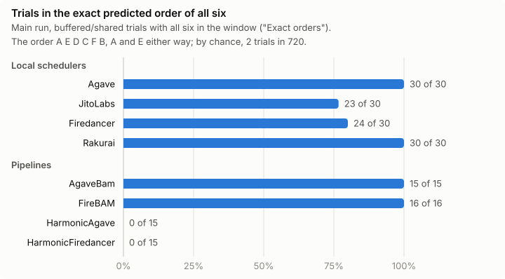
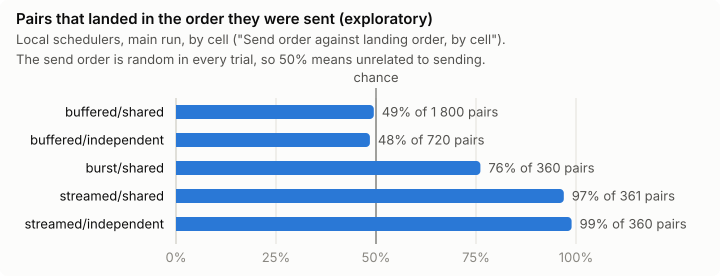

# Report: how Solana validators order transactions inside a block

**Status: final.** The main run was campaign `main`, on 2026-10-27 in epoch 1069, six days after Alpenglow. Its
analysis plan was frozen at the git tag `prereg-main` before the first trial:
- commit `9221dc9`, dated 2026-10-27 14:34:07 UTC by its author;
- GitHub started CI for that commit at 14:34:11 UTC
  ([run](https://github.com/bobxx22/solana-ordering/actions/runs/40522357305)), a time the author does not set;
- the campaign's first run started at 14:39:06 UTC ("Runs"). Its first transactions landed in slot 462 107 436, whose
  block time on chain is 14:39:08 UTC.

**Where the numbers come from.**
- Results are copied from [`results.md`](data/mainnet-beta/results/results.md), and trial by trial from
  [`orders.md`](data/mainnet-beta/results/orders.md). `node src/cli.ts analyze` regenerates both from the committed raw
  data. The section a number comes from is quoted in double quotes.
- Spend comes from [`ledger.jsonl`](data/mainnet-beta/ledger.jsonl). Wallet balances come from transactions on chain,
  named where they are used.
- The chain checks come from [`verify.json`](data/mainnet-beta/verify.json), [`verify/`](data/mainnet-beta/verify/)
  and [`verify-every-transaction.json`](data/mainnet-beta/verify-every-transaction.json).
- A few numbers add up rows of one table, and show the sum.
- Sections of `results.md` added after the data are marked "exploratory" there and here. "The plan" lists every
  addition.

## The answer

**The six roles** (terms: README, "Terms"). Each trial sends six transactions whose fees make the candidate rules
disagree:
- A and E, identical twins: 4 000 lamports of priority fee for a 1 000 compute-unit limit;
- B: 10 000 lamports for 40 000 compute units;
- C: no priority fee;
- D: 9 000 lamports for 6 000 compute units;
- F: A with a 64 MiB loaded-data limit.

By **reward per requested cost unit**, the formula in the deployed source of Agave 4.3.2 and Firedancer 26.10
(`docs/schedulers.md`), they rank A = E, D, C, F, B.
- Reward is the priority fee plus half of the base fee.
- Cost is the scheduling cost computed from the *requested* compute-unit limit and the *requested*
  loaded-accounts-data limit.
- By total priority fee they would rank B, D, A = E = F, C.

Three contrasts each isolate one term of that formula:
- **C before B** and **D before C** together place the share of the base fee counted as reward between 0.12 and
  0.84. The source uses 0.5.
- **A,E before F** shows that the requested loaded-data limit enters the cost.
- **A,E before C** is the positive control.

### Tested as pre-registered

**Local schedulers.** Agave, JitoLabs (Jito-Agave), Firedancer and Rakurai: 32.7% of mainnet's leader slots, of which
the validators we reached hold 22.2% ("Coverage per label").
- Transactions that wait in the leader's buffer are ordered by reward per requested cost unit.
- All twelve pre-registered tests hold: in every label, each contrast landed in the predicted order more often than
  chance allows, at Holm p ≤ 0.003.
- 107 of the 120 trials landed in the exact predicted order of all six ("Exact orders", local schedulers).
- Agave and Rakurai each rest on about four effective validators. Every conclusion is about the validators reached.

**Pipelines.** The BAM and Harmonic labels: 67.1% of the slots, of which the validators reached hold 22.8%.
- BAM (AgaveBam, FireBAM) ordered our transactions like the clients' schedulers: 31 of 31 trials in the exact order.
- Harmonic (HarmonicAgave, HarmonicFiredancer): A,E before F and D before C hold, C before B is "no stable order",
  and no trial landed in the exact order.

| label | share of leader slots | primary trials | control: A,E before C | A,E before F | C before B | D before C | exact order of all six |
|---|---:|---:|---|---|---|---|---:|
| Agave | 1.1% | 30 | 100% | 100% **holds** | 100% **holds** | 100% **holds** | 30 / 30 |
| JitoLabs | 24.9% | 30 | 100% | 87% **holds** | 77% **holds** | 100% **holds** | 23 / 30 |
| Firedancer | 5.5% | 30 | 100% | 100% **holds** | 90% **holds** | 100% **holds** | 24 / 30 |
| Rakurai | 1.2% | 30 | 100% | 100% **holds** | 100% **holds** | 100% **holds** | 30 / 30 |
| AgaveBam | 34.6% | 15 | 100% | 100% **holds** | 100% **holds** | 100% **holds** | 15 / 15 |
| FireBAM | 1.9% | 16 | 100% | 100% **holds** | 100% **holds** | 100% **holds** | 16 / 16 |
| HarmonicAgave | 21.9% | 15 | 100% | 100% **holds** | 33% **no stable order** | 100% **holds** | 0 / 15 |
| HarmonicFiredancer | 8.7% | 15 | 100% | 100% **holds** | 40% **no stable order** | 100% **holds** | 0 / 15 |

The table reads as follows:
- **Shares.** The per-trial share of the contrast's pairs that landed in the named order, averaged over trials, from
  "Primary" and "Pipelines".
- **Verdicts.** By the pre-registered rule: a one-sided exact test against chance, Holm-adjusted within each family
  of twelve. "Holds" means more often than chance; the last column shows how often the whole order held.
- **Slot shares.** From "Coverage per label".
- **Exact order.** From "Exact orders".



### Found after the data (exploratory)

These come from tables added after the main run ("The plan"). They locate and describe; they test nothing.
- **Three JitoLabs validators order by total fee.** All 7 trials (2 + 4 + 1) of 7cVfgArC, EvnRmnMr and C8Bey3LK
  landed in the exact total-fee order. The other 13 JitoLabs validators we reached: 23 of 23 in the reward/cost order.
- **One Firedancer validator departs.** JD549Hsb: 4 of 10 trials in the exact order. The other 9: 20 of 20.
- **Harmonic.** F came last in all 30 trials, and B and C either way round. Each of these orders is the reward/cost
  order for a base-fee share between 0.11 and 0.19 instead of 0.5. The design cannot tell that from a cost formula
  of Harmonic's own (section 6).
- **Arrival order** decides when the leader does not hold the transactions together, and between equal priorities.
  - Streamed 30 ms apart into a block being built, transactions landed in send order: 97–99% of pairs, against
    48–49% when buffered ("Send order against landing order").
  - Of two equal priorities, Firedancer put the later arrival first in 85% of trials, consistent with its source.
    Agave 4.3.2 showed no preference.



## How to check

```bash
docker compose up
```

This command:
- regenerates every table and compares it byte for byte with the committed ones;
- checks a sample of 120 blocks against the chain through public endpoints;
- makes one dry-run trial.

It needs no keys and sends nothing. GitHub Actions runs it on every push
([runs on `main`](https://github.com/bobxx22/solana-ordering/actions/workflows/ci.yml?query=branch%3Amain)): the job
`docker` runs the offline part in the image, and the job `reproduce-online` runs the whole command.

- `node src/cli.ts verify all --sample all` checks every landed transaction whole. Its committed result is
  `verify-every-transaction.json`.
- `git log prereg-main` shows the plan as frozen. The run directories are named by their UTC start.

**One trial by hand.** Trial 249 of session 2 went to the Agave 4.3.2 validator 5Us18hLZ, for its window from slot
462 133 072 (`orders.md`). It was sent in the order D A E C B F. The six landed as the first six transactions of that
slot's block:

| index | role | priority fee, lamports | signature |
|---:|---|---:|---|
| 0 | E | 4 000 | [4uHMPzNZ…](https://explorer.solana.com/tx/4uHMPzNZf6RLdBrCewC5u16iLsedCA1YHAX3p62aKrFpQxh7PW4JchVSaHJJwgmy5BCeosUX1nD6EhL4vbR2ia9Y) |
| 1 | A | 4 000 | [3VQBhCSe…](https://explorer.solana.com/tx/3VQBhCSeQkrsN8wYvwMC8BGBqgtgDkuKgBfSxVU7DznnfzoCtFWGZzW76TMEYEgYmSDMx71YZoPEV4c2M2eW2vrf) |
| 2 | D | 9 000 | [4CkmLSe4…](https://explorer.solana.com/tx/4CkmLSe4NyfNiZBqm38FWp2xMTzcocpxohoWXBSmFE6znX6foUa24WtUdfRAD7MLaT6UBzrrQs8tMLB1EfdthvWK) |
| 3 | C | 0 | [2qa4pgik…](https://explorer.solana.com/tx/2qa4pgiknj68vZiB5fvGAXzLkjXpfxp5TBXVhqMvnTkVoTMGKgkPCmYeqJ8yApHNNAEQ2GDgJLekDpbTHK2mC3ct) |
| 4 | F | 4 000 | [48QFUnnB…](https://explorer.solana.com/tx/48QFUnnB9j6zMPkekJY1Ww5Gi6NRiYpfAkZHP2V8C3X6mD1Hq12JBaAzLTdXoKxXNVNHoFaWB6NPVVhicVukNmka) |
| 5 | B | 10 000 | [52C1m8zN…](https://explorer.solana.com/tx/52C1m8zN344QNGQTXNQkt1rwrdPv1NW1dJ78q6Cx9f2Uj44Q9GvvRhgeaYtqzZjG93E1HXvK8EwxYd6YzUKdzDS5) |

The block's signatures, in order, from a public endpoint:

```bash
curl -s https://api.mainnet-beta.solana.com -H 'content-type: application/json' -d '{"jsonrpc":"2.0","id":1,"method":"getBlock","params":[462133072,{"transactionDetails":"signatures","rewards":false,"maxSupportedTransactionVersion":1}]}'
```

On each transaction's explorer page the ComputeBudget instructions show its role. A and E have the same instructions;
F differs from them only in `SetLoadedAccountsDataSizeLimit`.

## Measurements

All times UTC. Every slot is after Alpenglow's activation (slot 459 653 000, 2026-10-21). Slots and epochs are from
"Runs"; spend is from `ledger.jsonl`.

| date and time | what | path | data | slots | spent, SOL |
|---|---|---|---|---|---:|
| 2026-10-24 16:59 | validator snapshot by client | – | `snapshots/` | epoch 1066 | 0 |
| 2026-10-24 19:07 | funding 10 sub-payers | RPC | `ledger.jsonl` | – | 0.000010 |
| 2026-10-24 19:08–19:12 | pilot: 15 trials × 5 transactions | public RPC | `runs/2026-10-24T19-08-02Z/` | 460 963 380 – 460 964 625 | 0.000780 |
| 2026-10-24 19:30–19:31 | path probe: 8 single transactions per endpoint, 3 endpoints | 3 RPCs | `paths/` | – | 0.000207 |
| 2026-10-24 23:25 | QUIC feasibility: 6 single transactions straight to leaders | direct QUIC | `quic-test/2026-10-24T23-25Z*.jsonl` | 461 036 036 – 461 036 146 | 0.000054 |
| 2026-10-24 23:35–23:37 | calibration 1: 8 trials × 6 (buffered sent one slot ahead, not two) | direct QUIC | `runs/2026-10-24T23-35-52Z/` | 461 039 133 – 461 039 486 | 0.000371 |
| 2026-10-25 15:38–15:41 | calibration 2: 13 trials × 6 | direct QUIC | `runs/2026-10-25T15-38-55Z/` | 461 311 213 – 461 311 909 | 0.000732 |
| 2026-10-25 22:02–22:07 | rehearsal of the final code: 16 + 1 trials, the second run continuing the first | direct QUIC | `runs/2026-10-25T22-02-17Z/`, `runs/2026-10-25T22-05-59Z/` | 461 419 536 – 461 420 912 | 0.000986 |
| 2026-10-27 14:39–14:42 | **main run, session 1:** 30 trials × 6, ended by a power loss | direct QUIC | `runs/2026-10-27T14-39-05Z/` | 462 107 436 – 462 108 452 | 0.001769 |
| 2026-10-27 15:32–17:28 | **main run, session 2:** 373 trials × 6, continuing session 1 until every quota was met | direct QUIC | `runs/2026-10-27T15-32-51Z/` | 462 122 629 – 462 154 412 | 0.020821 |
| 2026-10-27 19:45 | sweep: the sub-payers' balances returned to the main wallet | RPC | `ledger.jsonl` | – | 0.000075 |
| | **total** | | | | **0.025805** |

**Wallets.** The ledger and the chain agree to the lamport:
- the main wallet (`mainWallet` in every `run.json`) received a single transfer of 0.058892 SOL, on 2026-10-24 at
  17:25 UTC
  ([3Vo8NW5j…](https://explorer.solana.com/tx/3Vo8NW5jEpuGfd4LaZgN1vCv7B5Y1Q99Cu8PCewECoPCeT4ReKtATLGnib6x132xeLWsVAkPQHhGjwAHraepqZhg));
- after the last sweep transaction
  ([2jZGDs4H…](https://explorer.solana.com/tx/2jZGDs4HgMYcnQ8duxVrvoN3XmvKssvgzYH99RF8WN3kNmRPnFyhgEDGS353CLq6XyXpg8o3GxyRCiqt4Ev4ppJf),
  2026-10-27 19:45 UTC, in the ledger) it held 0.033087 SOL: the 0.058892 SOL less the ledger's 0.025805 SOL. Both
  balances are in those transactions' metadata on chain;
- the main run cost 0.022665 SOL (0.001769 + 0.020821 + 0.000075), sweep included, under the 0.05 SOL cap in code.

**Chain checks.** All went through `api.mainnet-beta.solana.com`, which keeps the whole history, with PublicNode as a
fallback. 0 problems in each.

| check | when | runs | landed transactions | blocks | leader confirmed by the schedule | whole transactions | rows of whole blocks rebuilt | unlanded, absent from the chain | probes |
|---|---|---:|---:|---:|---:|---:|---:|---:|---:|
| `verify/2026-10-27T14-39-05Z.json` | 2026-10-27 15:32 | 1 | 174 | 31 | 31 | 60 (sample) | 1 227 (3 blocks) | 6 of 6 | – |
| `verify/2026-10-27T15-32-51Z.json` | 2026-10-27 18:50 | 1 | 2 048 | 406 | 406 | 60 (sample) | 1 438 (3 blocks) | 190 of 190 | – |
| `verify.json` | 2026-10-27 21:05 | 7 | 2 501 | 507 | 507 | 60 (sample) | 1 160 (3 blocks) | 220 of 220 | 30 of 30 |
| `verify-every-transaction.json` | 2026-10-28 15:12 | 7 | 2 501 | 507 | 507 | 2 501 (all) | 15 509 (30 blocks) | 220 of 220 | 30 of 30 |

What each check verifies:
- every landed transaction sits at its recorded index in its recorded block;
- each block's leader against the schedule, where an endpoint still serves it, otherwise against the block's
  fee-reward recipient;
- whole transactions for payer, fee, anchor and role parameters: a sample of 60 in the first three checks, every
  landed transaction in the last;
- the recorded rows of everyone else's transactions in a sample of whole blocks;
- every unlanded transaction is unknown to the chain.

The per-session files were made while epoch 1069's leader schedule was still served (`docs/RUNBOOK.md`, step 7).

## Results of the main run

### 1. Runs, coverage and versions

**The run.**
- 403 trials in two sessions ("Runs": 30 and 373), all in epoch 1069.
- The run stopped by itself once every quota was met:
  - 60 counted trials per local label, 30 per pipeline label;
  - a trial counts when B, C, D, F and A or E landed in the targeted window.
- Three addresses were excluded after failing twice without ever landing, one validator each:
  - a JitoLabs and a Rakurai validator behind port 11228;
  - an Agave validator.

**Coverage.** "Coverage per label", from the main run's snapshot. The last two columns are exploratory:

| label | validators | share of all leader slots | effective number | reachable share of its slots | validators reached | effective number reached | reached: share of all slots | reached: share of the label's slots |
|---|---:|---:|---:|---:|---:|---:|---:|---:|
| Agave | 20 | 1.1% | 4.4 | 96% | 10 | 4.2 | 0.9% | 81% |
| JitoLabs | 134 | 24.9% | 17.8 | 95% | 16 | 11.5 | 15.4% | 62% |
| Firedancer | 26 | 5.5% | 5.2 | 100% | 10 | 6.0 | 4.9% | 88% |
| Rakurai | 9 | 1.2% | 4.0 | 94% | 7 | 3.5 | 1.1% | 93% |
| AgaveBam | 353 | 34.6% | 60.3 | 100% | 13 | 11.8 | 6.4% | 19% |
| FireBAM | 20 | 1.9% | 3.3 | 100% | 10 | 4.4 | 1.5% | 77% |
| HarmonicAgave | 48 | 21.9% | 15.5 | 100% | 11 | 9.8 | 9.4% | 43% |
| HarmonicFiredancer | 38 | 8.7% | 8.4 | 100% | 8 | 6.1 | 5.5% | 64% |
| local schedulers | 189 | 32.7% | 25.9 | 96% | 43 | 20.7 | 22.2% | 68% |
| pipelines | 459 | 67.1% | 73.8 | 100% | 42 | 27.2 | 22.8% | 34% |

Small labels are concentrated in few operators.
- **Agave.** About four effective validators. We reached 10, with about the same concentration (4.2), holding 81% of
  the label's slots.
- **Rakurai.** We reached 7 of its 9 validators, with 93% of its slots. One of them took 40% of the primary trials
  ("Primary").
- **The large labels.** The validators reached hold 62% of JitoLabs' slots, but only 19% of AgaveBam's.

Every conclusion below is about the validators reached.

**Versions in the primary trials** ("Versions"):
- Agave: 4.3.2 ×23, 4.5.0-alpha.2 ×5, 4.4.0-rc.1 ×2. All three versions have the same priority formula; v4.4.0-rc.1
  was read after the run (`docs/schedulers.md`).
- Firedancer: 26.10.4 ×27, and ×3 for the unidentified build "0.1.1" (9% of the label's slots). All three of those
  trials went to one validator, FBbqKvwL (`orders.md`).
- Every other label: a single version (4.3.2 or 26.10.4).

**Ingress** ("Ingress", campaign `main`):
- Every Agave, JitoLabs and Rakurai trial went to the validator's own address. 7 of the 60 Firedancer trials went
  through a host shared by up to 5 validators.
- The pipelines' trials went through shared gateway hosts: up to 99 AgaveBam or FireBAM validators behind one host,
  and 4–5 hosts for all Harmonic trials.

### 2. Delivery and attrition

"Delivery", campaign `main`:

| cell | trials | sent | acknowledged by the leader's QUIC | landed | in the targeted window | spill-over | complete trials | arrival margin, ms (median, min) | reconnected before sending |
|---|---:|---:|---:|---:|---:|---:|---:|---|---:|
| buffered | 288 | 1 728 | 1 679 | 1 566 (91%) | 1 518 | 48 | 253 | 403, −1 111 | 41 |
| burst | 38 | 228 | 216 | 216 (95%) | 216 | 0 | 36 | −221, −569 | 6 |
| streamed | 77 | 462 | 462 | 440 (95%) | 434 | 6 | 72 | −418, −1 342 | 8 |
| all deliveries | 403 | 2 418 | 2 357 | 2 222 (92%) | 2 168 | 54 | 361 | 384, −1 342 | 55 |

- **Complete trials.** 361 of 403 trials were complete.
  - The run counted 360. The trial in flight at the first power loss was never checked by the run, but it is in the
    data and complete.
  - That trial is why FireBAM has 16 primary trials and the other pipelines 15.
- **Late arrivals.**
  - The arrival margin is how long before our clock saw the window open the leader had acknowledged the whole burst.
  - Some buffered bursts were acknowledged after the window had opened, by our clock (minimum −1 111 ms).
  - The pre-registered sensitivity analysis (section 8) drops such trials, as well as those that reconnected before
    sending.

### 3. Control

A,E before C was 100% of trials, p < 0.001, in every label of both families ("Primary", "Pipelines"): 30 trials for
each local label, 15 or 16 for each pipeline. Every label we tested orders by fee.

### 4. Primary tests: the local schedulers

"Primary", 30 buffered/shared trials per label; interval over trials, Holm p over the twelve tests:

| label | A,E before F | C before B | D before C |
|---|---|---|---|
| Agave | 100% [89–100%], p < 0.001 | 100% [89–100%], p < 0.001 | 100% [89–100%], p < 0.001 |
| JitoLabs | 87% [75–97%], p < 0.001 | 77% [60–90%], p = 0.003 | 100% [89–100%], p < 0.001 |
| Firedancer | 100% [89–100%], p < 0.001 | 90% [77–100%], p < 0.001 | 100% [89–100%], p < 0.001 |
| Rakurai | 100% [89–100%], p < 0.001 | 100% [89–100%], p < 0.001 | 100% [89–100%], p < 0.001 |

**All twelve hold**: each contrast landed in the predicted order more often than chance. The pre-registered reading
for each of the four labels:
- consistent with reward per requested cost, the requested loaded-data limit included;
- with a base-fee share between 0.12 and 0.84, which contains the deployed source's 0.5.

"Holds" is a statement about the trials, not about every validator: JitoLabs holds C before B at 77%, while three of
its validators order the other way (section 6).

**What this establishes.**
- **The cost.** It is computed from what a transaction *requests*, not what it uses.
  - F used the same 600 compute units as A and loaded the same accounts.
  - F still ranked below A and E in every trial of Agave, Firedancer and Rakurai, and in 87% of the JitoLabs pairs.
  - The only difference is its requested 64 MiB loaded-data limit, which costs it 16 384 compute units in the
    scheduler's formula.
- **The base fee.**
  - C pays no priority fee, yet it ranked above B, which pays 10 000 lamports for 40 000 compute units: in 77–100% of
    trials, depending on the label.
  - That happens only if more than 12% of the base fee counts as reward. The source counts half.
  - D before C caps that share below 84%.
- **The rules this rejects as the rule of these labels** (section 6 shows three JitoLabs validators that follow one of
  them):
  - priority fee per compute unit (price);
  - priority fee per cost without the base fee;
  - total priority fee;
  - "no order".

  Each of the first three predicts the opposite of at least one contrast that held. "No order" predicts chance level
  for all of them.

### 5. Pipelines: BAM and Harmonic

"Pipelines", a secondary family of twelve tests, read as statements about the whole pipeline behind the gateway:

| pipeline | trials | A,E before F | C before B | D before C |
|---|---:|---|---|---|
| AgaveBam | 15 | 100% [80–100%] holds | 100% [80–100%] holds | 100% [80–100%] holds |
| FireBAM | 16 | 100% [81–100%] holds | 100% [81–100%] holds | 100% [81–100%] holds |
| HarmonicAgave | 15 | 100% [80–100%] holds | 33% [13–53%] **no stable order** | 100% [80–100%] holds |
| HarmonicFiredancer | 15 | 100% [80–100%] holds | 40% [13–67%] **no stable order** | 100% [80–100%] holds |

**BAM.** The order our transactions got through the BAM pipelines is the clients' reward/cost order, in every one of
31 trials.

**Harmonic.**
- C before B is "no stable order", not "reversed": both intervals reach above 0.5. The pre-registered reading names
  no rule for it.
- A,E before F and D before C hold, as for BAM.
- "Rule agreement: buffered/shared" does not separate the rules here. Reward/cost gives a mean gamma of 0.76 and 0.77,
  priority fee per cost 0.81 and 0.80, with overlapping intervals.

Section 6 reads the orders themselves.

### 6. Exact orders, and where the deviations are (exploratory)

"Exact orders": trials with all six in the window, in exactly the order A E D C F B (A and E either way). By chance
that is 2 in 720.

| label | exact |
|---|---:|
| Agave | 30 of 30 |
| JitoLabs | 23 of 30 |
| Firedancer | 24 of 30 |
| Rakurai | 30 of 30 |
| AgaveBam | 15 of 15 |
| FireBAM | 16 of 16 |
| HarmonicAgave | 0 of 15 |
| HarmonicFiredancer | 0 of 15 |
| local schedulers | 107 of 120 |
| BAM pipelines | 31 of 31 |
| Harmonic pipelines | 0 of 30 |

The rest of this section reads two tables added to `analyze` after the main run, once the table above showed how few
deviations there were: "Deviations from the reward/cost order, validator by validator" and "JitoLabs by advertised
QUIC port". They are outside the pre-registered plan and test nothing, but they locate every deviation.

- **JitoLabs.** The deviations are three validators, all reporting JitoLabs 4.3.2.
  - All 7 of their trials (7cVfgArC 2, EvnRmnMr 4, C8Bey3LK 1) landed in the exact **total-fee** order: B (10 000
    lamports), D (9 000), then A, E and F (4 000 each) in any order, C (0) last.
  - That is the order the "total priority fee" candidate predicts, and the source does not.
  - The other 13 JitoLabs validators we reached: 23 of 23 trials in the exact reward/cost order.
  - **The relayer port.** EvnRmnMr advertises port 11228, which most likely belongs to a Jito relayer in front of the
    validator (README, "Shared gateways"). For EvnRmnMr the design does not separate the validator from a relayer.
    But the other 5 validators reached on that port landed their 7 trials in the reward/cost order (port 11228: 6
    validators, 11 trials, 7 reward/cost, 4 total fee). 7cVfgArC (port 8002) and C8Bey3LK (port 8022) advertise
    ordinary ports.
  - **Not late delivery.** The sensitivity filter of section 8 keeps 3 of the 7 trials (2 + 0 + 1). All 4 of
    EvnRmnMr's reconnected before sending (`orders.md`). The 3 that remain did not, were acknowledged at least
    100 ms before the window, and still came out in total-fee order.
  - C8Bey3LK's burst trial, the only other trial of the three with all six in one shared burst, also landed in
    total-fee order: BDAFEC (`orders.md`).
  - Within one client label and version, some operators order their blocks differently. Gossip cannot tell which
    code they run.
- **Firedancer.** One validator, JD549Hsb (26.10.4): 4 of its 10 trials in the exact order.
  - In the other 6, B came before F, and in 3 of those also before C.
  - Those six orders are also reward/cost orders, for a base-fee share below 0.19, like Harmonic's (next item).
  - The other 9 Firedancer validators we reached: 20 of 20 exact.
- **Harmonic.** All 30 trials, on 19 validators, landed in one of four orders: AEDBCF, AEDCBF, EADBCF, EADCBF.
  - A, E and D always came first, then B and C either way round, then F **last**. The same validator produced both
    B–C orders.
  - Each of the four is the reward/cost order for a base-fee share below the source's 0.5. B before C needs a share
    between 0.114 and 0.120; C before B, a share between 0.120 and 0.193 (`docs/schedulers.md`, "What the contrasts
    identify").
  - A heavier penalty on F's loaded-data request alone, at a share of 0.5, would put C before B in every trial
    (reward/cost 1.07 against 0.30). Harmonic did that in 33% and 40% of trials.
  - So Harmonic ranks like reward/cost with a smaller base-fee share that changes from block to block, or by a cost
    formula of its own. F's position alone does not show a heavier penalty, and the design does not separate the two.
  - One reading, untested: Harmonic blocks come from external builders, which may each count fees their own way.

### 7. Arrival order: the cells and the twins

**Send order, cell by cell** ("Send order against landing order, by cell", exploratory). The send order is a fresh
random permutation in every trial, so an order unrelated to sending puts half the pairs in send order:

| cell | local schedulers: pairs in send order | local schedulers: trials entirely in send order | BAM, Harmonic: pairs in send order |
|---|---:|---:|---:|
| buffered/shared | 49% | 0 of 120 | 46%, 48% |
| buffered/independent | 48% | 0 of 48 | 48%, 48% |
| burst/shared | 76% | 1 of 24 | 47%, 39% |
| streamed/shared | 97% | 21 of 25 | 99%, 100% |
| streamed/independent | 99% | 22 of 24 | 96%, 97% |

- **Buffered.** The send order leaves no trace: the scheduler ranks.
- **Streamed 30 ms apart** into a block being built: nearly every pair lands in send order, for every label. A leader
  that is already producing schedules each transaction as it arrives.
- **A burst one slot into the window** sits in between for the local schedulers (76%). The pipelines rank it (47% and
  39%, 6 trials each).

**Streamed, the contrasts** ("Secondary: streamed", local labels):
- The twin sent first landed first in 96% of trials (23 of 24 in each mode).
- The fee contrasts sit at chance level: 32% to 71%.

**Burst, the contrasts** ("Secondary: burst", local labels, 24 trials):
- A,E before F 56%, C before B 58%.
- The twin sent first landed first in 83%.
- Six transactions arriving together while the block is being produced are ranked only partly. Some are scheduled
  before the others have arrived.

**Buffered, independent accounts** ("Secondary: buffered/independent"):
- Without a write-lock conflict the six may run on parallel threads and be recorded in completion order.
- Firedancer kept the full order (100% in all four contrasts, 12 trials).
- Agave nearly kept it (83–96%).
- JitoLabs (50–83%) and Rakurai (75–100%) lost part of it.
- The design does not separate thread count from operator configuration here.

**The twins A and E**, equal priority, by how the deployed version breaks ties ("Twins by how the deployed version
breaks ties", buffered/shared). The share is how often the twin sent first landed first:

| version family | trials | twin sent first landed first | what the source says |
|---|---:|---|---|
| Agave 4.3.2, Jito included | 53 | 42% [29–55%] | container id, not arrival: chance level expected |
| Agave 4.4/4.5 pre-releases | 5 | 80% [38–96%] | oldest first |
| Firedancer 26.10.3-4 | 27 | **15% [6–32%]** | newest first (read after the run) |
| Rakurai | 30 | 53% [36–70%] | source not read |

**Firedancer ties** (the source was read after the run).
- Before the run we expected no particular order between Firedancer twins.
- The data showed the twin sent second landing first in 85% of trials.
- That is consistent with Firedancer's source (`docs/schedulers.md`, "Read after the main run"). Its treap places a
  newly inserted transaction of equal priority after the existing ones, and pack schedules from the best end, so the
  newer one goes first.
- The rule is about the order in which transactions enter pack. Between QUIC and pack sit the signature-verification
  and dedup stages, so that order need not be the send order. That may be why 4 of the 27 trials went the other way,
  on four different validators, none of which had reconnected (`orders.md`). We did not test it.
- In independent mode the same share is 8% of 12 ("Secondary: buffered/independent").

### 8. Robustness

**Leave one validator out** ("Robustness of the primary"):
- No rerun changes any of the twelve verdicts.
- The worst Holm p is 0.022, for JitoLabs C before B. Every other worst p is below 0.001.

**Validator level** ("Validator level"): per validator the mean share minus 0.5, one-sided sign flip over validators.
- Every primary contrast is significant at the validator level:
  - Agave (10 validators), JitoLabs (16) and Firedancer (10): p < 0.001, except JitoLabs C before B, p = 0.011.
  - Rakurai (7): p = 0.008, the smallest value 7 validators allow.
- The order is a property of the validators reached, not of a few of them.
- Pipelines, grouped by ingress host:
  - AgaveBam (8 hosts) p = 0.004 and FireBAM (6) p = 0.016 throughout;
  - Harmonic has only 4 hosts, so p = 0.063 is the smallest possible. C before B there gives 0.500 and 0.875.

**Per validator** (at least 5 primary trials, "Robustness of the primary"):
- Every listed validator had 100% in all four contrasts, except Firedancer JD549Hsb: C before B 70% of 10.

**Sensitivity** ("Robustness of the primary"). It drops trials that reconnected before sending, had an unknown or
under-100 ms arrival margin, or ran on a clock other than `firstShred`.
- Agave keeps 29 trials, JitoLabs 20, Firedancer and Rakurai 30. Every contrast keeps p ≤ 0.001.
- JitoLabs rises to 88% (A,E before F) and 85% (C before B), because the filter drops 4 of the 7 total-fee trials of
  section 6, all of them EvnRmnMr's ("Deviations", kept by the sensitivity filter).
- The 3 that remain reconnected nowhere and were acknowledged at least 100 ms before the window, yet still came out
  in total-fee order. That order is the validators' own, not an effect of late delivery.

### 9. Context in the block

**Where our transactions sit** ("Where our transactions stand in their blocks").
- **Out-ranking.** By reward per scheduled cost, A and E out-rank 99% of the other transactions in their blocks, D
  95%, C 86%, F 80% and B 79%.
- **Buffered position.** Buffered transactions sit at the very head of the block: A and E at 1% of its length, D 2%,
  C 6%, F 8%, B 9%. The order within the head is the order of their priority.
- **Burst and streamed position.** Burst and streamed transactions land mid-block (35–58%).
- **Blocks.** 472 blocks held our direct-path transactions, with 110–1 429 transactions each (median 458.5).

**Everyone else in the same blocks** ("Background").
- Position correlates negatively with reward per scheduled cost in every label: median Spearman rho −0.06 to −0.36
  over the whole block, −0.21 to −0.58 over its first 10%; rho < 0 in 68–96% of blocks.
- The head of a block is ranked; the rest only weakly.
  - That fits a leader that ranks what is waiting when its block starts, then schedules later arrivals as they come
    (section 7).
  - It also fits blocks that mix ordinary transactions with bundles.
- This is context, not a test: the other transactions' requested limits are rebuilt from the chain, and their
  arrival times are unknown.

**Rule agreement** ("Rule agreement: buffered/shared", all local labels, 120 trials, 42 hosts). Mean gamma:
- reward/cost 0.91 [0.79, 0.99];
- priority fee per cost 0.56;
- price per compute unit 0.46;
- total fee −0.24;
- send order −0.01.

### 10. What the results do not show

- **Ordinary transactions.** Our roles out-rank 79–99% of their blocks. The results describe how a scheduler ranks the
  head of its queue, not how it defers low-priority traffic.
- **Staked senders.** We delivered as an unstaked peer. In the sources we read the ranking formula has no stake term;
  stake changes which packets get in (QUIC quality of service), so a staked sender should see fewer drops rather than
  a different order. We did not measure it.
- **Inside the pipelines.** For BAM and Harmonic, we cannot tell the sequencer or builder from the validator. Only the
  pipeline as a whole is measured.
- **Harmonic's rule.** Its orders fit reward/cost with a smaller base-fee share; we cannot tell that from a cost
  formula of its own.
- **The exact base-fee share.** The contrasts bracket it (0.12–0.84); they do not pin it to 0.5.
- **Why some validators differ.** The three total-fee JitoLabs validators, Firedancer JD549Hsb and the "0.1.1" build:
  we see what they do, not what code they run. Client labels and versions are what validators report in gossip. For
  EvnRmnMr we cannot tell the validator from a relayer in front of it.
- **Validators we did not reach.** The validators reached hold 22.2% of mainnet's leader slots through the local
  labels and 22.8% through the pipelines; AgaveBam is the least covered (19% of its slots). Agave and Rakurai are
  small, concentrated labels.
- **Other times.** One day, one epoch (1069). Schedulers change with releases; the pre-releases already break ties
  differently.
- **Arrival inside the leader.** The QUIC acknowledgement proves delivery, not when each transaction reached the
  scheduler.

## What went wrong

### During the main run

| what | how we found it | what we did |
|---|---|---|
| The operator's computer lost power after the 30th trial of session 1 (the last line of its `run.log` is 14:42:46). The last trial was never landing-checked, 6 reservations stayed open, the ledger lock stayed in place, and collection did not run. | The run stopped. | `collect all` at 15:29 settled the 6 open reservations, and found the stale lock on the same host and took it over. Session 2 continued the campaign at 15:32. The unchecked trial is in the data but was never counted towards its quota, so FireBAM has 16 primary trials. |
| The runbook (step 7) commits each session's data before the next session starts. Session 1's data were collected and checked first (15:29–15:32), but committed at 15:49 (`2f230f3`), after session 2 had started at 15:32. | `git log` against "Runs". | Reported here. Session 2 started from what `collect` had written; nothing was edited by hand. |
| The chain check of session 2 was interrupted twice: by an operator time limit and by a second power loss. | Its file was missing. | Rerun, finished at 18:50, still inside epoch 1069: all 406 leaders were confirmed by the schedule. |
| The full check first left part of the 220 unlanded transactions unchecked. A history search for a signature the chain does not know is slow on the public endpoint, so one request for all 220 overran the client's 30 s timeout. `verify` counted them as unchecked, as designed, not as absent. | `verify` summary. | Requests of 10 signatures (`src/verify.ts`). The rerun checked 220 of 220. |
| Three addresses never landed anything and were excluded, each after two failures in a row: a JitoLabs and a Rakurai validator behind port 11228, and an Agave validator. | `events.jsonl`, `exclude`. | Reported as the reachable share of each label: Agave 96%, JitoLabs 95%, Rakurai 94%. |
| 41 of 288 buffered trials reconnected to the leader just before sending; some bursts were acknowledged after the window had opened. | "Delivery". | The pre-registered sensitivity analysis leaves them out (section 8). |
| Agave 4.4.0-rc.1, a version whose source had not been read, appeared in the snapshot (2 primary trials). | "Versions". | Read after the run: same priority formula, oldest-first ties. The twins table, frozen earlier, lists it under "other versions". |

### Before the main run

| what | how we found it | what we changed |
|---|---|---|
| The public RPC held bursts ~1.3 s and released them in its own order, so the pilot measured the RPC, not the leader. | Round-1 reviews of the pilot. | Direct QUIC delivery to the leader's advertised TPU address (`py/tpu_sender.py`). The pilot is kept as the comparison it became (below). |
| 7 of 22 pilot dispatch attempts were skipped as "missed slot": a `>=` instead of `>`, and signing too late. | Pilot log and ledger. | Fixed; skips are logged in `events.jsonl`. |
| The pilot run crashed waiting 160 s for a rare client's window (fixed 120 s timeout), so the automatic collection did not run. | Pilot log. | Timeout proportional to the distance; collection runs after any error. |
| The block's fee-reward recipient is not always the leader: some validators collect block revenue in a separate account. | QUIC feasibility test. | The leader is the slot's scheduled leader (`getSlotLeaders`); the fee recipient is stored separately. |
| BAM and Harmonic validators advertise shared gateways, so "direct to the leader" is direct to a gateway for them. | Round-2 reviews; confirmed from the snapshot. | Ingress host recorded per trial; BAM and Harmonic get their own family of tests, read as pipelines, with a check grouped by host. |
| reward/cost and price per CU disagreed on one pair only. | Round-1 reviews. | Role F (A with a 64 MiB loaded-data limit). |
| The rebuilt cost of other transactions ignored the requested loaded-data limit. | Round-2 reviews. | Cost rebuilt from first principles; a test checks it equals the design cost for all six roles. |
| Spend-cap gaps (reservations released on a send error or after 20 s; sweep could be refused; two processes could spend). | Round-1 reviews (no overspend happened). | Reservations close only on landing or proven expiry; sweep allowance; exclusive, host-aware ledger lock; genesis-hash check. |
| One payer set would never have been topped up during a long run. | Round-2 review (not triggered yet). | Payers pre-funded for the whole run and checked before each use. |
| `verify` defaulted to an endpoint that keeps ~40 h of blocks. | Round-3 review. | Full-history endpoint first; unavailable blocks reported, not failed; leader falls back to the fee recipient. |
| Reviewers asserted FIFO tie-breaking from Agave `master`. The deployed v4.3.2 breaks ties by a container id; only the 4.4/4.5 pre-releases (about a fifth of the Agave label's slots) break them by arrival. | Reading the tagged sources (round 4 found the pre-releases). | Twins reported by version family; `docs/schedulers.md` corrected. |
| The live loop stopped on any transient error, could not be continued, and exclusion memory was per campaign, so one unlucky start could exclude a 100-validator gateway. | Round-3 and round-4 reviews. | Per-iteration recovery; campaigns that continue a stopped run; address history from every live run. |
| REPORT quoted pilot numbers that `analyze` did not produce. | Round-4 review. | `analyze` emits them; this report copies `results.md` only. |
| Free Helius plan: 1 sendTransaction/s, no staked connections; free dRPC does not serve mainnet. | Provider documentation; probe. | Helius is used for reads only. |
| Docker Desktop cannot run on the author's Windows build. | Installer error. | The image is built in GitHub Actions on every push, and the tests and the offline `reproduce` run in it. The full online `reproduce` runs in a separate job that does not fail the build, because public endpoints rate-limit shared runners ([runs on `main`](https://github.com/bobxx22/solana-ordering/actions/workflows/ci.yml?query=branch%3Amain)). |
| The recorded rows of other transactions in 18 blocks of the pilot and calibration runs had a stale scheduled cost: 2 280 CU per Ed25519 precompile signature instead of the deployed 2 400. The code had been corrected, but those blocks were collected before the fix. | The new comparison of whole blocks with the chain (the round-5 review asked for it). | The three runs recollected (`collect --refresh`): 24 rows of 18 blocks changed, only in that field (`git diff 9221dc9^ 9221dc9 -- data/mainnet-beta/runs`). |
| `verify` reported unlanded transactions as checked when no endpoint answered. It took an empty answer from the first endpoint as final, and would have accepted "unknown" from an endpoint whose history does not reach the send slot. | Round-5 review; one block came back empty from the public endpoint while re-checking. | Unlanded transactions are asked only of endpoints whose history reaches their send slot, and count as checked only when one answered. An empty answer passes the request on to the next endpoint. |
| `results.md` gave the pilot 75 transactions "in the targeted window" in one table and 19 in the next line. | Round-5 review. | The window is now the targeted leader's window for every path; the pilot rows show 19 and a spill-over of 56. |
| Four statements in README and REPORT did not match the code: a spend "at most 0.022 SOL" (the bound is the 0.05 SOL cap), "no wallet key is read" (true of `run`, not of `fund`, `sweep` or `status`), the online `reproduce` in CI (it does not block the build), and "statistics resample hosts". | Round-5 review. | Corrected. |

## Before the main run: the pilot and the calibration

**The delivery path decides everything.**
- The pilot sent through the public RPC's `sendTransaction` ("Rule agreement: pilot through the public RPC", row "all
  pilot trials"). The block order followed the order in which the RPC released our transactions: gamma 0.87 [0.71,
  0.97], Holm p = 0.005. Reward/cost gave 0.23, p = 1.000.
- The "Pilot path" line: the RPC answered after a median 1 302 ms (176–3 340). That response time correlates with the
  landing delay at r = 0.91. Only 19 of 75 transactions (25%) landed in the targeted window.
- Straight to the leader over QUIC, the main run landed 2 168 of its 2 222 landed transactions in the targeted window
  ("Delivery", all deliveries).

**The calibration and the rehearsal** ("Calibration and rehearsal runs") were descriptive and never entered a test.
They already showed the main run's pattern:
- rehearsal, buffered/shared: A,E before C, A,E before F and D before C at 100% of 7 trials; C before B 86%;
- streamed/shared: the twins in send order in every trial (3 in calibration, 2 in the rehearsal).

## The plan

### Amendments before the main run

The analysis plan was first committed at `d86fc31`. An independent full review (round 5) found that parts of it would
have misread the data. It was amended before any trial of campaign `main`, and the amended plan is the one tagged
`prereg-main`:

- **Verdicts.** "Contradicted" (interval below 0.75) would have read chance-level order (share near 0.5) as an
  alternative rule, for example "the base fee does not count". It is split:
  - "reversed" (interval below 0.5) is the only verdict read as an alternative rule;
  - "no stable order" (below 0.75) names none.

  This is the verdict the Harmonic C-before-B results received.
- **Minimum.** Fewer than 10 trials is "insufficient data", not "no fee ordering detected".
- **Quota.** A trial counted when any two of its transactions landed, so 30 primary trials could leave a contrast with
  about 25 pairs (power 0.62 instead of 0.76 at an 80% share). It now counts only with B, C, D, F and A or E in the
  targeted window.
- **Pipelines.** The four BAM and Harmonic labels hold about two thirds of mainnet's leader slots. They get their own
  family of twelve tests, read as statements about the pipeline.
- **Validators.** Agave and Rakurai each rest on about four effective validators. Added:
  - a group-level sign-flip check per label;
  - each label's coverage;
  - conclusions stated for the validators reached.
- **Sensitivity.** Trials with an unknown arrival margin are left out, not kept.
- **Twins.** Only versions whose source was read enter a version family.

**What we had seen.** The amendments were written after the calibration and rehearsal runs, whose data were already
committed. They include 6 buffered Harmonic trials (`orders.md`, campaigns `calibration` and `rehearsal`): F came last
in 5, and B and C came in both orders. The verdict the Harmonic C-before-B results then received, "no stable order",
names no rule, so it favours no hypothesis. The pipelines' own family follows from the shared gateways found in round
2.

### Added after the main run

Nothing in the plan changed after the data. Added, and marked as such:
- **Exploratory tables** (sections 1, 6 and 7). They read the same trials and test nothing:
  - deviations from the reward/cost order by validator, with each validator's port and how many of its trials the
    sensitivity filter keeps;
  - JitoLabs by advertised QUIC port;
  - send order against landing order, by cell;
  - the share of leader slots held by the validators reached.
- **Presentation.**
  - Rows that pool labels or deliveries in "Exact orders", "Delivery" and "Coverage per label".
  - The "Ingress" table restricted to campaign `main`; it had counted the calibration and rehearsal trials too.
  - Each trial's port, reconnect and arrival margin in `orders.md`.
  - The note that an interval falls back to Wilson's when every trial has the same share.
  - The two charts, drawn by `analyze` from "Exact orders" and from the send-order table.
- **Sources read to explain what the data showed** (`docs/schedulers.md`):
  - Firedancer's tie rule and Agave v4.4.0-rc.1's priority formula ("Read after the main run");
  - the order of the six for every base-fee share ("What the contrasts identify"), used to read the Harmonic orders.
- **`verify`.**
  - Smaller status requests, so that the history search fits the public endpoint's timeout.
  - `--sample all` and `--out`, for the check of every landed transaction.

  They change no result.
